> [!WARNING]
> This was vibe-coded in its entirety, as a way to get experience with LLM-based
> development (and save my sanity while job hunting).
> 
> I'm making this public so I can more easily share this with friends who are also job hunting.
> This is provided as is with no warranty. Do whatever you want with this, but don't come crying to
> me if it doesn't work. It's a vibe-coded throwaway tool --- nothing more.

# JobHuntPA

A personal job search dashboard that runs on your own computer. It collects jobs from SEEK and
company careers pages, filters them against your search settings and map pins, scores the rest
against your CV with an AI model of your choice, drafts cover letters, suggests job titles to
search for, researches each employer, merges the same job advertised on several sites into one,
flags ads that may be ghost jobs, and lets you chat with the AI about any job. Your searches and
documents are stored encrypted under a key of your own (what that does and doesn't cover is
under [How your data is protected](#how-your-data-is-protected)), and one copy can serve a few
people, each with an account of their own.

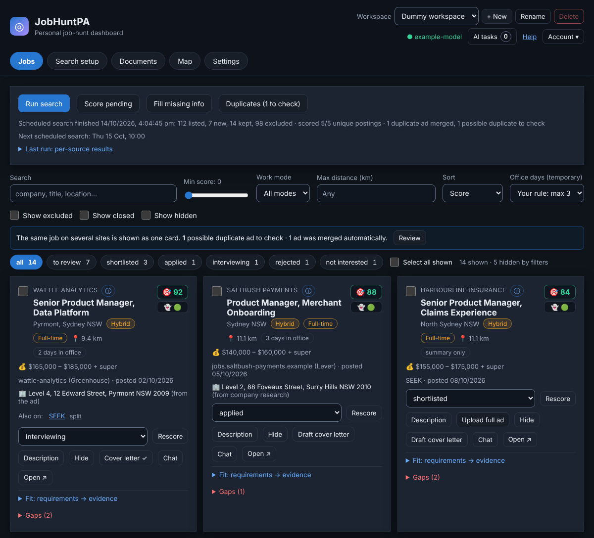

*All screenshots show a made-up job hunt in a demo workspace: the person, companies and ads are fictional.*

## A quick look

**A job's full page** (*Open ↗* on any job): the office on a map with the commute there and back,
how well the job fits your CV and where the gaps are, what company research found about the
employer, and the whole ad.

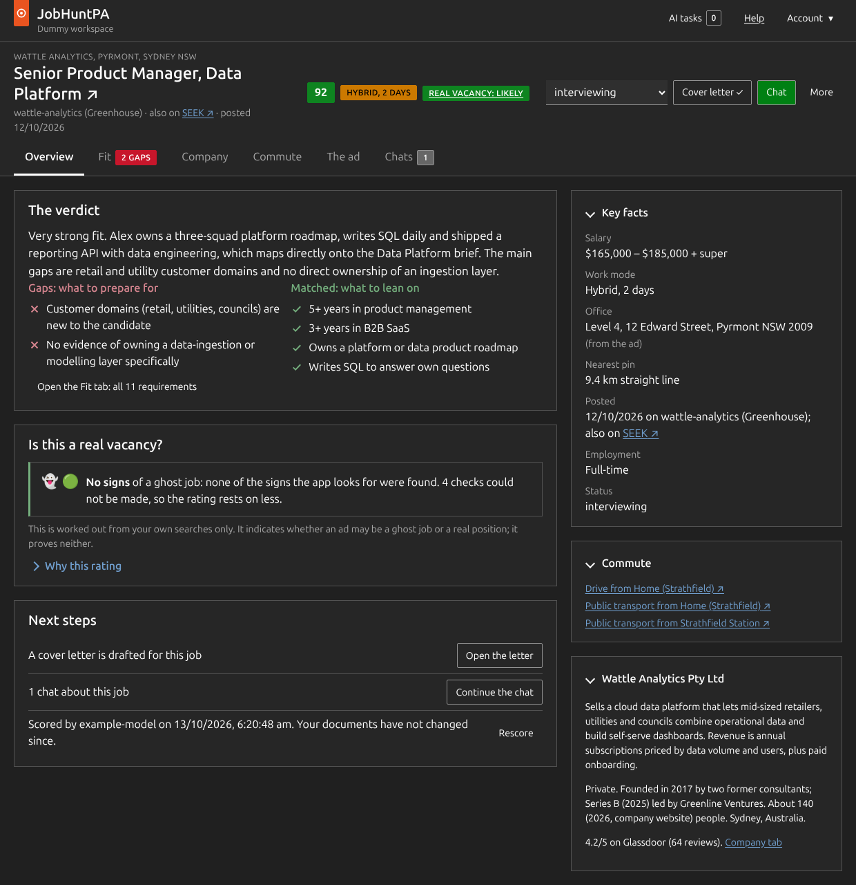

**Map**: the jobs your filters show, your pins with their radii, and the jobs in view listed
underneath.

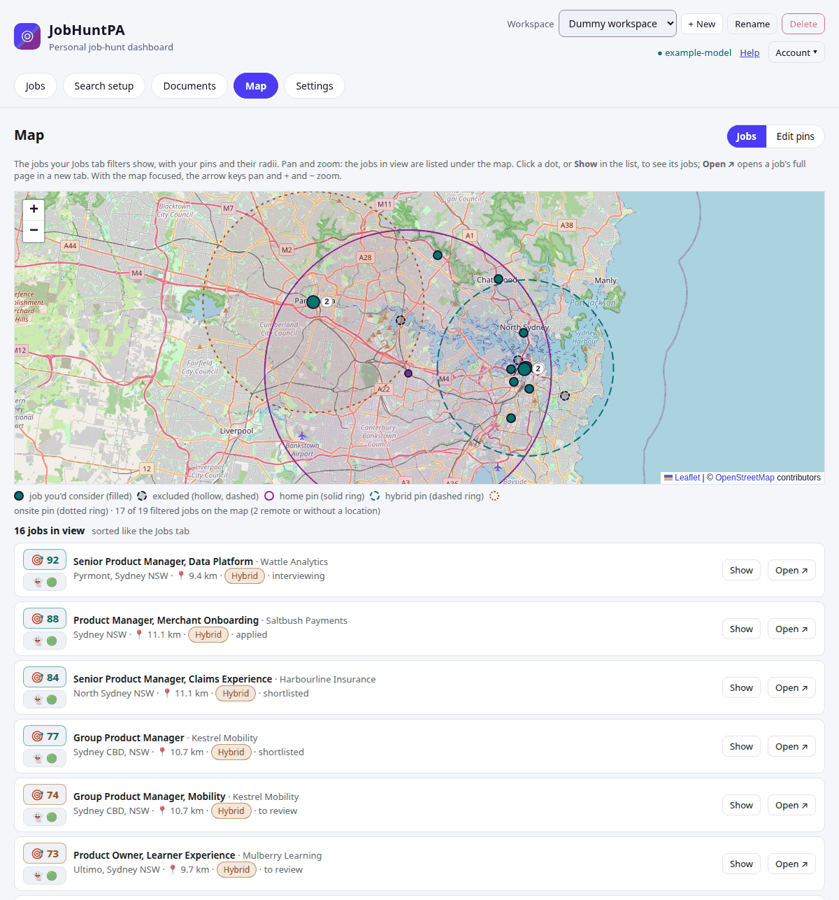

**Chat about a job**: ask how well you fit, what to prepare for an interview, or compare jobs.

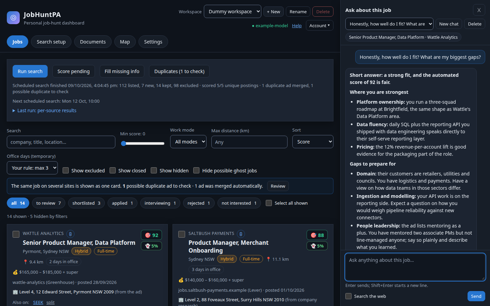

**Cover letter drafts** from your own documents, to edit, copy or download as a Word file.

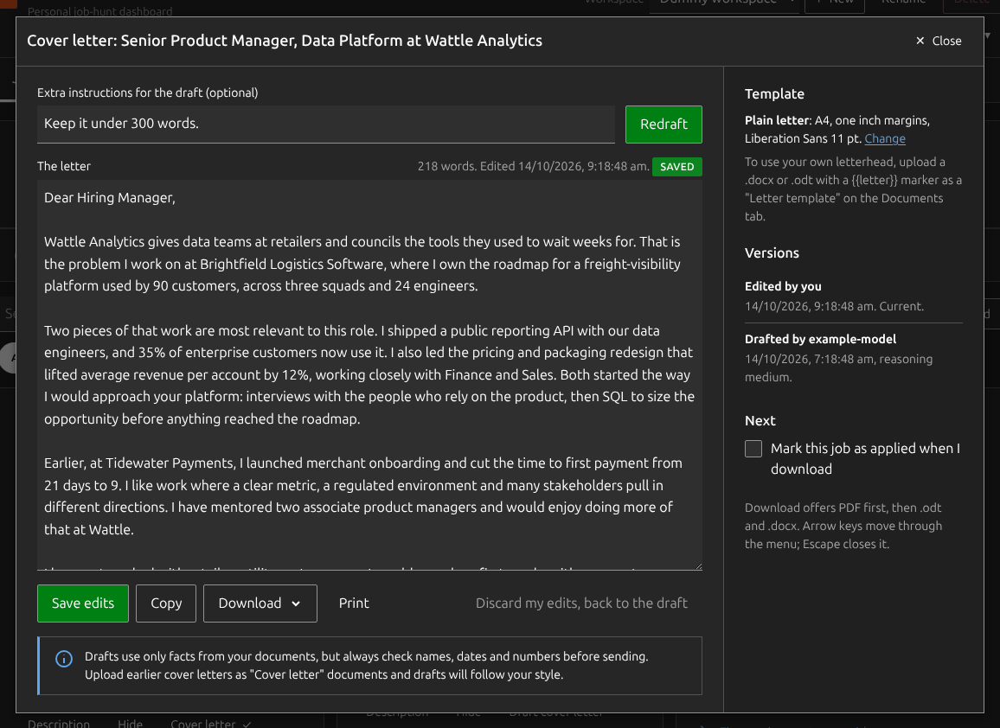

**Settings**: the theme, scheduled searches (by themselves at set times on workdays, skipping public
holidays), the AI status with the Rescore buttons, and [your account](#your-account) (password, two-step
sign-in, recovery codes, background access, download your data). The admin sets the AI provider and the
commute keys in the admin panel.

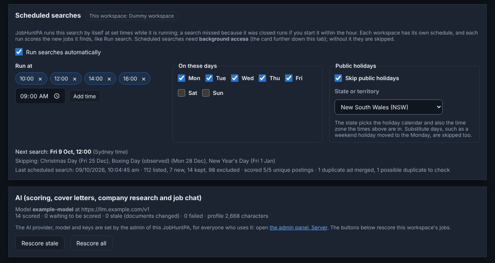

**Themes**: Dark (above), Light, the Catppuccin, Rosé Pine, Nord, Kanagawa and Everforest
families, a dyslexia-friendly theme and themes for colour vision deficiencies, picked from live
previews on the Settings tab.

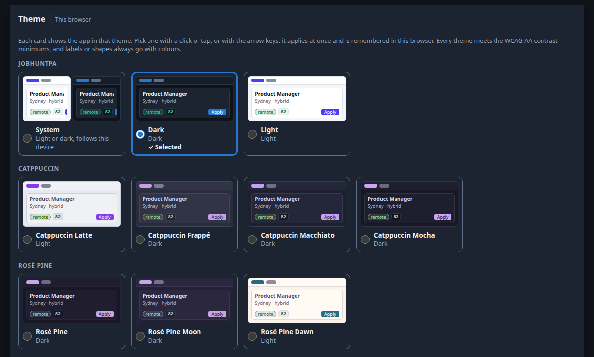

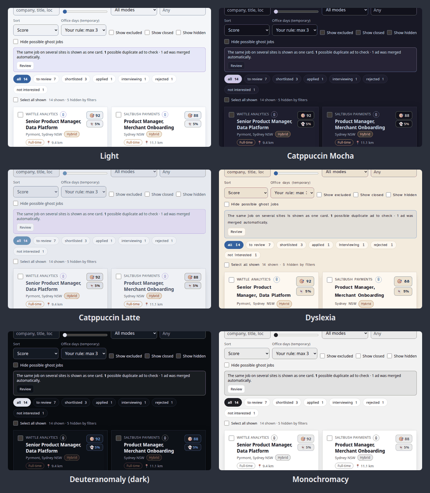

More: search setup and the per-source run report

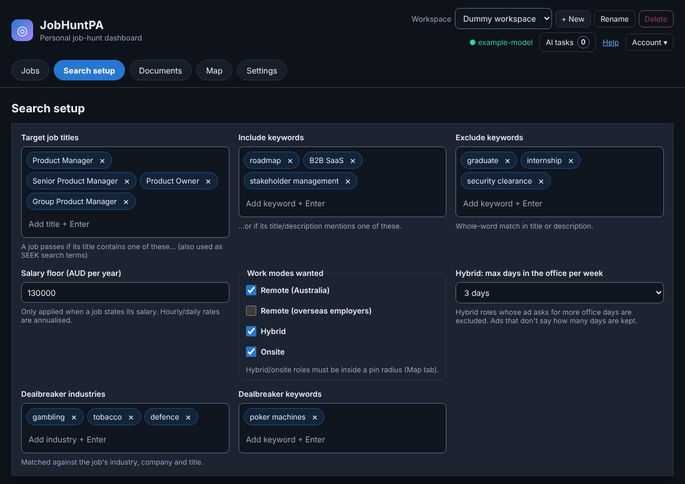

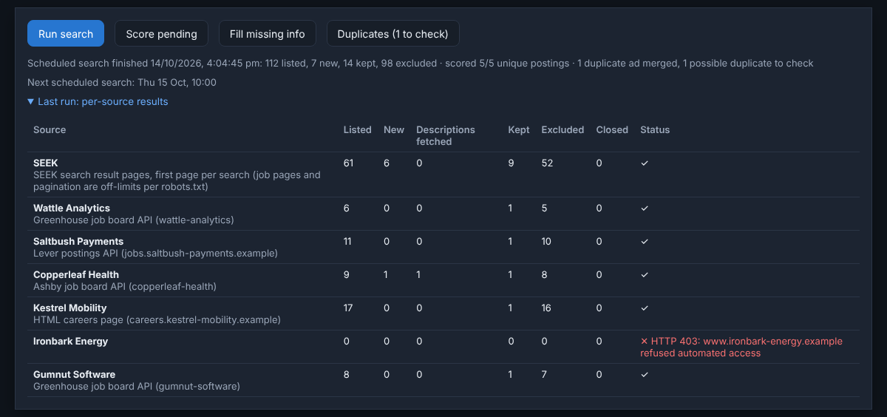

## What you need

- A computer running Windows 10/11, macOS or Linux, and an internet connection.
- An **API key for an AI model (LLM)** from one of the major providers: [OpenAI](https://platform.openai.com/),
  [Anthropic (Claude)](https://platform.claude.com/), [Google Gemini](https://aistudio.google.com/),
  [Meta](https://dev.meta.ai/) (Muse Spark), Mistral, Groq, xAI (Grok), DeepSeek or OpenRouter, or
  any other service with an OpenAI-compatible API. A model running on your own computer with
  [Ollama](https://ollama.com/) needs no key. Setup lets you pick the provider, then asks for the
  model and your key; you can change them any time in the admin panel (Account > Admin > Server). Using the model costs
  money on your provider account. The app still collects and filters jobs without one, but
  scoring, cover letters, title suggestions, chat and company research need it.
- Company research, finding offices and *Search the web* in chats use the provider's web search,
  which OpenAI, Claude, Gemini, Meta, xAI and OpenRouter offer. With the others everything else
  works, and the app says when a feature needs web search.

Setup takes about 5-10 minutes and needs no technical knowledge. JobHuntPA runs on your computer and
keeps your jobs, documents and API key there; there is no JobHuntPA service. What leaves it is the
requests the app makes to your chosen AI provider, to the job sites and the map and commute services it
searches, and, if an admin turns them on, email and Stripe. [How your data is protected](#how-your-data-is-protected)
says what is encrypted and what isn't.

## Install on Windows

1. Go to the [latest release](https://github.com/florian3706/JobHuntPA/releases/latest) and
   download **JobHuntPA-Setup.exe**.
2. Double-click it. Windows may say *"Windows protected your PC"* because the program isn't
   signed: click **More info**, then **Run anyway**.
3. Press Enter to accept the install folder, then answer the questions about your AI provider.
   Setup installs Python for you if needed (no admin rights required).
4. When it finishes, start JobHuntPA from the **JobHuntPA** shortcut on your Desktop or in the Start
   menu. A window opens with the app's messages and your browser opens the dashboard. Keep that
   window open while you use JobHuntPA; close it to stop the app.
5. The first time, the browser asks you to [create your account](#your-account). It is the admin
   account, and anything already in JobHuntPA moves into it.

## Install on macOS

1. On this page click the green **Code** button, then **Download ZIP**, and unzip it (for example
   into your Documents folder).
2. In the unzipped folder, **right-click `Setup.command` and choose Open** (the first time macOS
   asks whether you're sure, because it was downloaded: click **Open**).
3. Follow the questions in the Terminal window. If Python is missing, setup offers to install it
   with Homebrew or opens the python.org download page; install it and run `Setup.command` again.
4. Start JobHuntPA by double-clicking **`Start JobHuntPA.command`**. Keep the Terminal window
   open while you use it; close it to stop the app.
5. The first time, the browser asks you to [create your account](#your-account).

If double-clicking doesn't work: open Terminal, type `cd ` (with a space), drag the folder into
the window, press Enter, then run `./setup.sh` once and `./start.sh` to start.

## Install on Linux

1. Download the ZIP (green **Code** button, then **Download ZIP**) and unzip it, or
   `git clone https://github.com/florian3706/JobHuntPA.git`.
2. Open a terminal in the folder and run `./setup.sh`. If Python 3.10+ or its `venv` module is
   missing, setup shows the command to install it and offers to run it.
3. Start JobHuntPA from your applications menu (setup adds it) or with `./start.sh`.
4. The first time, the browser asks you to [create your account](#your-account).

## Your account

JobHuntPA has accounts, so one copy can serve several people, each with their own workspaces. Your
account's cards are on the **Settings** tab, below the theme, schedule and AI cards: password, two-step
sign-in, recovery codes and signed-in devices, your email address and background access, then job digest
emails, download your data and delete account.

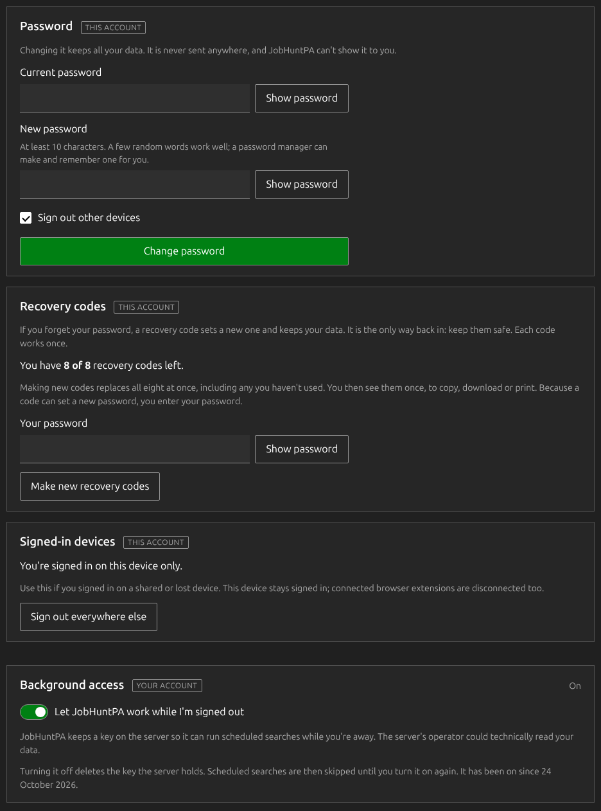

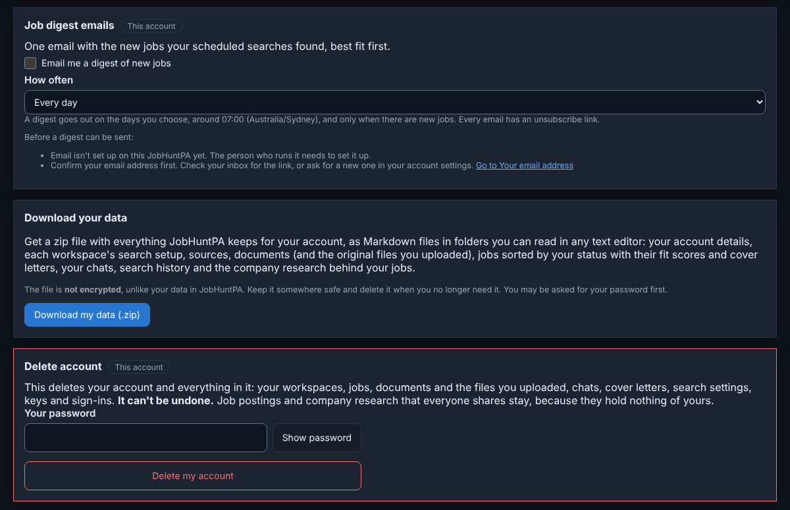

- **The first start** opens a page that creates the first account: your email address, an optional
  name and a password of at least 10 characters (a few random words work well; your password manager
  can fill it in). That account is the **admin**. Everything already in JobHuntPA (workspaces, jobs,
  documents, searches and settings) moves into it. The page's address carries a one-time setup
  code; if the browser didn't open, the address is printed in the JobHuntPA window, and the code is
  in `data/first-run.txt`. Once the account exists the code stops working and the file is deleted.
- **Recovery codes:** the first-run page then shows 8 recovery codes. Copy, download or print them
  and keep them somewhere safe: if you forget your password, they are how you get back in and keep
  your data. A reminder stays at the top of the dashboard until you confirm you've saved them; to see
  them again before that, JobHuntPA asks for your password (and a code, with two-step sign-in on).
- **The setup walkthrough:** once your recovery codes are saved, a new account opens a short
  walkthrough (`welcome.html`) instead of the dashboard. It starts with **choosing a theme**, which
  changes the page as you pick it, then sets up your search a step at a time: job titles; places,
  remote/hybrid/onsite work, days in the office and your home suburb; a salary floor and words or
  industries to include or avoid; automatic searches (background access and digest emails); and an
  optional résumé (on the Documents tab, where it powers the fit scores). Every step has Back, Next
  and Skip for now, saves as you go, and picks up where you left off if you close the page. "Skip the
  walkthrough" at the bottom goes straight to the dashboard; everything is on the Search setup tab
  later. On an existing install the first admin gets a short version: choose a theme, then keep the
  search settings that moved into the account or review them step by step. Your theme is saved with
  your account (encrypted with your key), so a new browser or device shows it too.

### Signing in

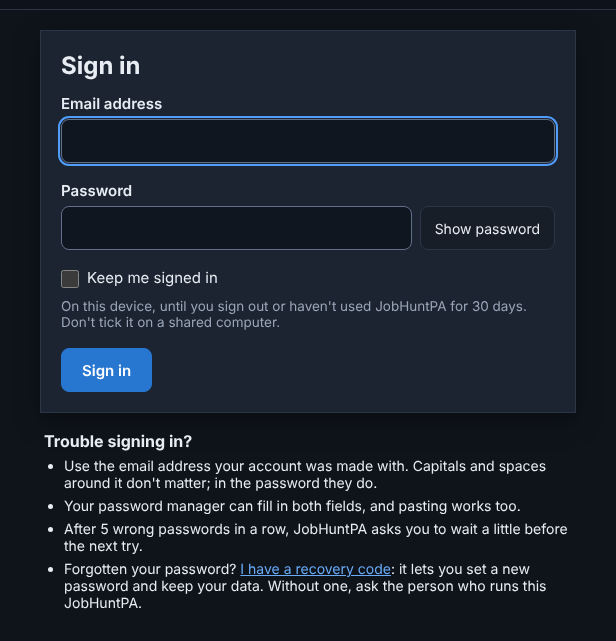

- **Staying signed in:** you are signed out after 24 hours of not using JobHuntPA, and after 7 days
  whatever you do. Tick *Keep me signed in* on your own device to stay signed in for up to 30 days of not
  using it (90 days at most). Don't tick it on a shared computer. **Account > Sign out** at the top right
  signs this browser out.
- **Wrong passwords:** after 5 wrong passwords in a row **from one place** (one network address, or one
  browser you have signed in with before), the next try from that place waits 30 seconds, then longer
  each time, up to 15 minutes. The wait is for that place only: someone who knows your email address and
  keeps guessing locks out their own address, never you. If wrong tries come from very many addresses at
  once (100 an hour), a browser you have never signed in with is asked to wait a while; the browsers you
  usually use are not. Wrong two-step codes have a lower limit of their own (10 an hour from places you
  haven't signed in from), and a password-reset link is used up by its 5th wrong code: ask for a new one.
  One network address can also make only 10 sign-in requests in 5 minutes. A small cookie (`jh_device`)
  remembers a browser you have signed in with; it proves nothing about your password and opens nothing.
  The counts are kept in memory, so restarting JobHuntPA clears them.
- **Two-step sign-in** (Settings > Two-step sign-in): add an authenticator app (any app that makes 6-digit
  codes) by scanning the QR code, or by typing the setup key if you can't scan. After that, signing
  in asks for the app's code after your password. A code works once, and a recovery code works instead
  of the app (each recovery code once; the page says how many are left). Turning it off needs your
  password and a code.
- **Forgot your password?** On the sign-in page, *Trouble signing in?* then *I have a recovery code*:
  enter your email, a recovery code and a new password. **Your data is kept**, because the recovery
  code unlocks it; every other browser is signed out. With two-step sign-in on, you also enter the
  app's code or a second recovery code. This works without any email set up.
- **Forgot your password and have no recovery code?** If an admin has [set up email](#setting-up-email),
  the sign-in page offers *Email me a link*. Type your address: whether or not an account has it, the
  page answers the same ("If an account has that address, we've sent a link"), so nobody can use it to
  find out who has an account. The link works once and lasts 1 hour; only the newest link works. With two-step
  sign-in on, you also enter the app's code (or a recovery code). What happens to your saved searches
  depends on **[background access](#background-access)**: **with it on, your data is kept**, because the
  server can unlock it; **with it off, the data is locked with your old password and can't be unlocked, so
  the page asks you to tick "I understand my saved data will be deleted"**: your workspaces, jobs,
  documents and uploads are then deleted and you start again with an empty "My job search" and new
  recovery codes (your account, membership and sign-in stay). Either way, every other browser is signed
  out, you are signed in, and you get a "Your password was changed" email. **With data kept, your old
  recovery codes stop working and you are shown eight new ones to save** (someone who had an account on
  your address before you could otherwise still use theirs). **If you are an admin, you also lose your copy
  of the admin key** (the server can unlock your data but not that key, see
  [background access](#background-access)): the page says so, and another admin uses *Share the admin key
  again*. If you have a recovery code, use it instead: it keeps your data and, if the code is a current one,
  your admin key too.

### Your details and devices

- **Your email address** (Settings): once email is set up, a new account gets a link to confirm its address
  (*Send it again* is on the Settings tab; the link lasts 24 hours). An address an admin invited you at counts as
  confirmed only if the invitation was really emailed to that address; a link an admin copied and sent
  another way proves nothing about the mailbox, so you get the usual confirmation email. **Changing your
  address** asks for your password (and a code from the app with two-step sign-in on), sends a link to the *new*
  address, and changes nothing until its owner opens the link **and presses the button on the page it shows**
  (opening it alone, as a mail scanner might, does nothing); the old address gets a notice when you start and
  when it is done, and Stripe (if you pay) is told the new address for its receipts. You are also emailed when
  your password is changed, when new recovery codes are made and when an admin turns off your two-step
  sign-in. These emails never contain your address or any of your data.
- **Password, recovery codes and devices** (Settings > Password, Recovery codes and Signed-in devices): change
  your password (your data stays readable, and other browsers are signed out unless you untick that), make 8
  new recovery codes (the old ones stop working; you enter your password, and with two-step sign-in on also the
  app's code; you save the new ones the same way as the first set), and *Sign out everywhere else* (which also
  disconnects your [browser extensions](#browser-extension)). Anything
  sensitive asks you to confirm your password first, if you haven't entered it in the last 15 minutes. If you
  think someone had your session, change your password, make new recovery codes and sign out everywhere else.
- **Delete your account** (Settings > Delete account): enter your password and everything of yours is
  removed: workspaces, jobs, documents and the uploaded files, chats, cover letters, keys and
  sessions. Job postings and company research that everyone shares stay, because they hold nothing of
  yours. It can't be undone, and it waits while one of your searches is running. An admin can delete
  their own account while another admin remains (the admin key is replaced for the others, so the one
  you held opens nothing new); the last admin can't, because nobody would be left to run JobHuntPA.
  Make someone else an admin first. The admin panel's **Delete** button removes exactly the same things.
- **What only the admin sees:** the AI provider, model, API key and reasoning levels, the
  commute API keys, the [email](#setting-up-email) settings and the [Stripe](#memberships-and-payments-optional)
  keys are set by the admin for everyone (admin panel, Server). Other accounts see whether AI
  scoring and commute times are available, and everything of their own: workspaces, search setup,
  documents, schedule and theme. Each workspace belongs to one account; nobody else can open it. How
  admins let other people in is under [Sharing JobHuntPA (admins)](#sharing-jobhuntpa-admins).
- **Headless servers and CI:** instead of the first-run page, start JobHuntPA with
  `JOBHUNT_ADMIN_EMAIL` and `JOBHUNT_ADMIN_PASSWORD` in its environment (exported, or in the
  service definition; never in `.env`, which is ignored for these two) and that admin is created
  at start-up. Its recovery codes are shown after its first sign-in.

### Download your data

**Settings > Download your data** makes a zip file with everything JobHuntPA keeps for your account, as
Markdown files in folders made for people:

- `Account.md`;
- for each workspace: its search setup, sources, documents (with the original files you uploaded, byte
  for byte), jobs sorted into folders by your status (each with its fit score, description, cover
  letter, the signs of a possible ghost job and the other sites that advertised it), jobs the filters
  left out, your chats and search history;
- the company research behind your jobs.

Links between the files work offline. It asks for your password again if you haven't entered it in the
last 15 minutes. The zip is made in memory, so nothing is written to disk on the server. An export is
refused above 200 MB of files, and the server makes only a couple at a time: try again in a minute. An
export keeps its place until your download has ended, so a slow or abandoned download holds it for up to
10 minutes, plus the time the zip needs at 100 KB/s. **The zip is not encrypted**: keep it somewhere
safe. It holds only your own data (admins can't export other people's), and never your password,
recovery codes or keys.

### How your data is protected

Your searches, documents and jobs are **encrypted with a key that only your password or a recovery
code can unlock**. Someone who copies the database, its backups or the `data/` folder can't read
them by looking, not even the person who runs this JobHuntPA, unless you allow background access
(below). That is the whole promise: it protects data at rest. It does not stop someone who changes the
running app or reads its memory (see *The limits*), and it is not a promise about anything outside
JobHuntPA, such as your AI provider.

> **Save your recovery codes.** If you forget your password, a recovery code is the only way to get
> your data back. Without one, your encrypted data can't be opened again by anyone.

**Encrypted** (under your key):
- each workspace's name, search setup (titles, keywords, salary, places, commute stations and
  times), dealbreakers and map pins (their places and radii);
- your jobs: their status, whether you hid them, why the filters excluded them, distance and
  place, the office you set or that was found, your call on the location, and anything that is only
  yours, such as a full ad you uploaded or a job imported from a saved page (its address too);
- fit scores and their evidence, cover letters, chats, and what each search run found;
- your documents and notes (title, text and concise version), and **uploaded files**: they are
  stored encrypted (`data/uploads/*.sealed`), and their text is read in memory, never written out;
- company careers pages you added, your commute lookups (cached per account) and your theme.

Even whether a job is hidden or excluded doesn't show: those fields are always stored encrypted,
and an excluded job looks the same as one you kept.

**Not encrypted**, because the app needs them without your key or they aren't yours. Someone with the
database can see:
- **job ads themselves**: ads are public, so they're stored once and shared by everyone's searches. Which
  ads your workspace has is visible (not what you think of them), and that shows roughly what you search
  for and when each ad was first linked to you. A job imported from a saved page is the exception: it is
  sealed, address included;
- company research (public, shared by everyone), which companies were researched (not by whom), which
  places were looked up, and AI usage counts for each account and purpose;
- how many workspaces, jobs and documents you have, how long each text is (the stored length is the
  text's length plus 33 bytes), the size of each uploaded file, and every date and time: when jobs were
  seen or closed, when searches, chats and sign-ins happened (your last active day is stored by day only);
- the kind of each document and pin, which documents are used for scoring, the kind and state of each
  search run, and the AI model names;
- when each workspace's scheduled searches run, including its state, and which ads you merged or split;
- your account's sign-in and billing state: role, whether two-step sign-in and background access are on,
  membership status, plan, period and free searches used (your email address and name are encrypted for
  admins only).

**Logs.** The messages JobHuntPA prints in its window name the kind of failure and an account number,
and never your email address, names, job text, documents, chats or any password, token or key.
`tests/test_log_leaks.py` runs a whole account through the app with everything planted in it and checks
this at the most detailed logging level. Two things are outside that check: the one-time setup code is
printed on purpose, and the traceback of an unhandled error (a bug) could name data.

**The limits.**
- **Your AI provider** sees what it scores, chats about or writes (your documents, the jobs, your chats)
  under the provider's own retention rules. The cache keys sent to providers are hashes of your documents.
- **Other services:** the mail provider sees the contents of your job digest emails (titles, companies and
  fit summaries), and Stripe sees your email address and payment details.
- **The running app** holds your data in memory while you use it, and memory can end up in swap files or
  crash dumps. Someone who changes the app's code on the server, sees the traffic before HTTPS is applied,
  or reads its memory could capture your password when you next sign in. Nothing stored on disk can
  prevent that.
- **With [background access](#background-access) on,** whoever runs the server can read your data, using
  the key file, but not other people's names, emails and billing details: the admin key stays closed to the
  server (see *Background access*).
- **Wrong passwords** are counted per place in memory (see *Signing in*), so a restart gives each place its
  five tries back. A guesser with many addresses gets 5 tries per address up to 100 an hour for the whole
  account (10 wrong two-step codes); IPv6 addresses count one by one, so a whole /64 can rotate through that
  ceiling.
- **Old copies of a key** (a spent recovery code, or background access you turned off) can stay in the database's log file
  for a short while until it is cleaned up; JobHuntPA checks every 10 minutes. On SSDs and SD cards, deleted
  data may linger in storage the disk manages itself.
- **Other accounts on the same computer** can't read the `data/` folder, the database or its backups:
  JobHuntPA makes them readable by you only (on Windows it relies on the folder's permissions). The
  computer's administrator (root) and you can still read everything.

**If someone can change the database file, not only copy it,** a few things in it are not protected by
your key: the lookup values the app needs before anyone signs in (which account an email address
belongs to, who is an admin, who has two-step sign-in on, who is turned off), the public keys used
to share the admin key, and membership details. With those they could send a password link to their own
address, or receive the admin key the next time an admin is made or the key is replaced. They could also
turn an account's two-step sign-in off in the database (the password is still needed) or give it a
membership. A password link for an account with background access is only accepted for the address inside
the account's own encrypted details, and every link carries the server's signature, so a link can't be
made by editing the database alone. For an account without background access, a link sent to the wrong
address deletes that account's data and never discloses it. The admin key opens only people's names,
emails, notes and billing details, never searches, documents or jobs. Someone who has the database **and**
`data/server-keys.json` can do anything the server can with the data of accounts that have background
access, and can still edit the public keys above, but **can't open the admin key**, even when an admin has
background access (see *Background access*).

**Whoever controls the mail route** (the mail server and public address in Admin > Server) receives every
password reset link, so changing them is guarded: see [Setting up email](#setting-up-email). On an account
without two-step sign-in they could still use the "forgot password" form (for an account with background
access that keeps the data). Turn two-step sign-in on if that matters to you.

### Background access

Settings > **Background access** is a switch for your account.

- **Off** (the default for a new account): only you can unlock your data. JobHuntPA can't run
  searches while you're away, so **scheduled searches are skipped** (the schedule card says so).
- **On** (ticked by default on the first-run page): JobHuntPA keeps a key on the server so it can run scheduled
  searches while you're away. The server's operator could technically read your data.

How it works: turning it on (it asks for your password again if you haven't typed it in the last 15
minutes) stores a copy of your data key locked with the server's own key, in `data/server-keys.json`.
Whoever has the database **and** that file can read the data of every account with it on. Turning it
off deletes that copy at once. The setup walkthrough's *Automatic searches* step turns it on for you
if you tick it. Back up `data/server-keys.json` with the database; it also records that the one-time
encryption of an older install has finished, so restore the two together.

**Background access doesn't open the admin key.** Everyone's name, email and billing details are locked
with the *admin key*, and an admin opens it with a second key of their own (an *identity key*) that only
their password, a recovery code or their signed-in browser can unlock, never the server's key. So a copy of
`data/` (the database and `server-keys.json`, which is what the uninstaller's backup holds) opens the
searches, documents and jobs of accounts with background access, but **not people's personal and billing
details, even when the admin who holds the admin key has background access too**. Scheduled searches and
digests don't need it and work as before. What this means in practice:
- Admins open people's details only while signed in. A browser that was already signed in when JobHuntPA was
  updated shows "Sign in again to open people's details" in the admin panel: sign out and in again.
- An existing account gets its identity key at its next password sign-in (or recovery-code reset); until
  then an admin's old arrangement still applies, so every admin should sign in once after updating. That
  sign-in gives the admin a new key pair and replaces the admin key (so a copy of `data/` from before can't
  open anything current). An admin who hasn't signed in yet doesn't get the new key until they have: sign
  in, then another admin chooses *Share the admin key again*. Making someone an admin who hasn't signed in
  since the update waits for their sign-in too, and so does turning on background access.
- **Delete the old `.bak-*` files** (`data/*.bak-before-encryption`, `*.bak-before-job-pool`, the
  uninstaller's zips once you have no use for them; the admin panel's **Server** section lists and deletes
  the first two). They keep the keys from before the update, so someone who has one together with the key
  file can still read what they held.
- **Recovery codes saved before the update can't carry the identity key.** (Codes you hadn't yet confirmed
  saving do carry it, unless the account has background access.) An admin who resets their password with a
  saved one keeps their data but needs another admin to share the admin key with them again; Settings >
  Recovery codes suggests making new codes (it takes a minute).

### Job digest emails

A digest is one email with the new jobs your scheduled searches found, best fit first. Each job shows its
title, company, pay, where and how it is worked, a short summary, your fit score and a link to the
original posting, and a line "Possible ghost job: ..." when the ad shows [signs of one](#ghost-jobs). Up to 60
jobs are shown; the email says how many more there are. The email carries your job titles and companies
through your mail provider, so turn digests off if you don't want that.

- **When:** around 07:00 in your search schedule's time zone (New South Wales if you have none), every
  1 to 7 days as you choose. Nothing is sent when there are no new jobs.
- **What it needs:** email set up by an admin, a confirmed address, Background access on (the server
  has to open your jobs without you), and, when memberships are on, a membership for scheduled searches.
  Settings > **Job digest emails** lists what is missing and links to where you fix it.
- **Turning it on or off:** use the switch in Settings, or tick it in the setup walkthrough's *Automatic
  searches* step. Every digest ends with an **Unsubscribe** link that opens a page with one button; it
  needs no sign-in and changes nothing until you press it. Right after you unsubscribe, the page offers
  *Subscribe again* for an hour; later, turn it back on in Settings. Mail programs that offer an
  "Unsubscribe" button work too.

## Sharing JobHuntPA (admins)

Admins open the **admin panel** from **Account > Admin** (`admin.html`). It never shows anyone's jobs,
documents or searches. It has five parts:

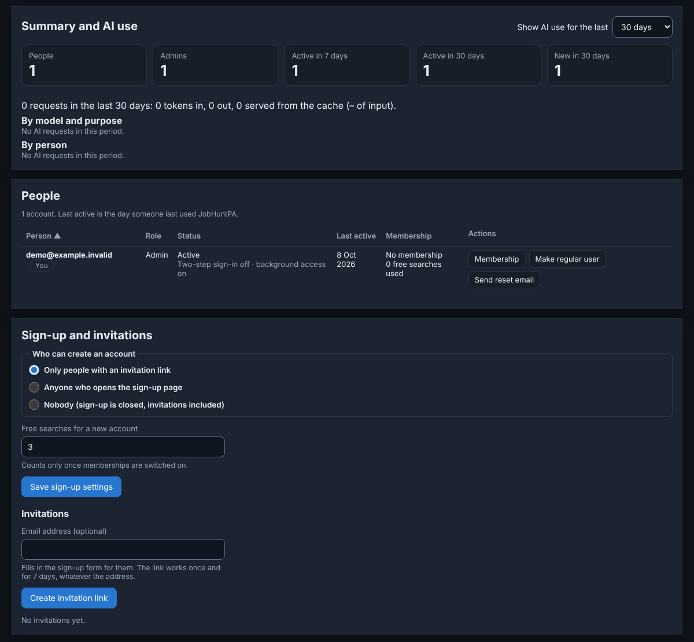

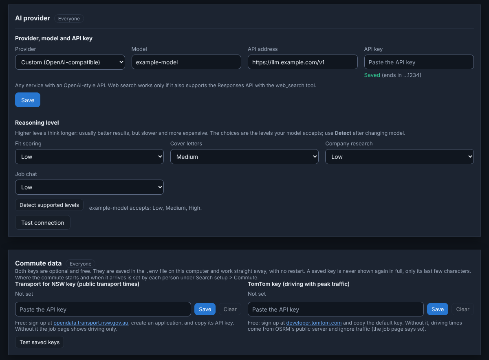

- **Summary and AI use:** people, admins, how many were active in 7 and 30 days and how many joined
  in 30 days, and the AI service's use for the last 7 to 365 days: requests, tokens in and out, and
  how much came from the cache, by model and purpose, by person and by day.
- **People:** each account's email, name, role, status, last active day and membership. The columns
  sort (below 640 px wide, each person becomes a card with a "Sort by" menu). Buttons make someone an
  admin or a regular user, disable or enable them (someone who pays by subscription keeps being charged
  while they are off and can't cancel it themselves: the panel says so, and *Membership* can end it;
  disabling an admin replaces the admin key, and enabling them again does not share it: use *Share the
  admin key again*), **unlock** someone who has to wait after wrong
  passwords, turn off their two-step sign-in, **delete their account** (with everything in it, their
  uploaded files included; not your own, not the last admin and not while their search is running; deleting
  an admin replaces the admin key like demoting does), and open their
  membership: **exempt from payment**, the number of free searches used, and **free periods**
  (start, end or number of days, a note only admins see; "End now" keeps the period in the history).
  Disabling, and changing a membership or a free period, ask for your password again if you haven't
  entered it in the last 15 minutes: free access and switched-off accounts are what a stolen session
  would use first.
  *Send reset email* sends them the same one-hour link as "Email me a link" (they choose the password; an
  admin never sets one). While email isn't set up it says so, and the person can use a recovery code on the
  sign-in page instead.
- **Sign-up and invitations:** choose who can create an account: **only with an invitation link** (the
  default), **anyone** (open sign-up) or **nobody**. An invitation link (`signup.html?invite=…`) is shown
  once when you make it, works for one sign-up and lasts 7 days. Give an email address to fill in the
  form for them; the address then counts as verified, and the link is also emailed to that address when
  email is set up (you can always copy it instead). New people get
  recovery codes and the setup walkthrough, as on first run. Open sign-up lets anyone who can reach the
  server use the AI service you pay for (unless [memberships](#memberships-and-payments-optional) limit it), so use it only on a private network.
- **Server:** the AI provider (provider, model, key, reasoning levels, *Test connection*), the commute
  keys, [email](#setting-up-email) and the **Payments (Stripe)** card
  (see [Memberships and payments](#memberships-and-payments-optional)); changes are logged by name, never the value;
  **Replace the server key** (see below); and the report of
  **unencrypted copies of data** with *Delete these files now* for the backups and old page cache that
  the one-time encryption leaves.
- **Audit log:** every admin action, newest first: what was done, by whom, to whom, and details such as
  dates or counts (never anyone's content). The details are readable while you hold the current admin key.

### The admin key and the server key

**The admin details key.** People's emails, names, notes and billing details are encrypted
so that only admins can open them, with an *admin key* that each admin holds a copy of (sealed to their
own identity key, which their password, recovery codes and signed-in browser unlock but the server's key
does not; see [Background access](#background-access)). Making someone an admin shares the key with them. Making an admin a regular user, or
**disabling** or deleting one, **replaces the key** and shares the new one only with the admins who
remain and are turned on, so the person who was removed can't open anything new. (Disabling an admin
needs your own copy of the key; an admin you enable again gets the key only when you *Share the admin
key* with them.) These actions ask for your password again if you haven't entered it in
the last 15 minutes. JobHuntPA keeps you from removing the last admin and warns while only one exists:
with a single admin who loses their password and recovery codes, nobody can read people's details. If
an admin shows "Admin key not shared with them", use *Share the admin key again* (another admin does
this). If no admin can open the key any more, see [Troubleshooting](#troubleshooting).

**The server key.** The server key (`data/server-keys.json`) protects the keys kept for
background searches and two-step sign-in. *Replace the server key* moves them all to a new one and drops
the old one; if something can't be moved, the old key is kept and nothing is lost. You can also run
`python -m backend.keys rotate-kek` with JobHuntPA stopped. The app holds a lock on its key file for as long
as it runs, however it was started, and these commands refuse while they can't get it (if the launcher's
`data/running.json` is left over from a crash, delete it). A running JobHuntPA also won't overwrite a key file that something
else changed: it stops with "The key file was changed by something else", and a restart picks up the new file.

### Reaching JobHuntPA from other devices and addresses

JobHuntPA only answers requests for an address it knows, so a web page on another site can't make your
browser talk to it under a name of its own (a "DNS rebinding" attack). It answers these:

- **any IP address**: `http://127.0.0.1:8000`, a home-network address such as `http://192.168.1.20:8000`,
  or a Tailscale address (`100.x.y.z`);
- **`localhost`** and names ending in `.localhost`;
- **this computer's own names**: its host name, with or without `.local` (`http://raspberrypi:8000`);
- **the public address** set in Admin > Server > Email (`PUBLIC_BASE_URL`);
- **any other names you list** in `.env`, separated by commas: `JOBHUNT_ALLOWED_HOSTS=jobs.example.com,pi.tail1234.ts.net`.
  Use names only (no `http://`, port or path); restart JobHuntPA after editing `.env`.

The port never matters. Anything else gets "This address isn't allowed" (HTTP 400) and nothing else runs.
**With `tailscale serve`** (or any proxy that passes the name people typed on), set the public address to
the address it gives you, such as `https://pi.tail1234.ts.net`: that is enough, and it also makes the
sign-in cookie secure. Without a public address, list the name in `JOBHUNT_ALLOWED_HOSTS` instead.
Start JobHuntPA through `start.sh` or the launcher, which already trust the proxy on the same computer
(`--proxy-headers --forwarded-allow-ips 127.0.0.1`). The proxy must **append** the real visitor's address to
`X-Forwarded-For` (`tailscale serve` and the usual proxies do); one that passed a visitor's own header through
unchanged would let anyone choose the address JobHuntPA counts their sign-in tries under.

**Give JobHuntPA a host name of its own.** The sign-in cookie is kept per host name, and browsers ignore the port,
so JobHuntPA puts the port into the cookie's name (`jh_session_8001`): a test copy on port 8001 and the live app
on 8040 on one computer don't sign each other out. Other apps on
the same host name still receive the cookie, though, so use a name only JobHuntPA answers to (such as
`jobs.example.com` or its own Tailscale name) rather than sharing `localhost` or a host name with other
web apps.

### Setting up email

Email is optional and off until an admin sets it up in **Admin > Server > Email**: the mail server
(*SMTP*), the *From* address, and the **public address** (the web address people use to reach
JobHuntPA, such as `https://jobs.example.com`; links in emails point to it, and `http` is only
accepted for `localhost`). While the server, the From address or the public address is missing, everything that needs email is off and says so:
reset links, address checks, invitations by email and security notices. Nothing else changes.

| Setting | What to enter |
|---|---|
| Mail server and port | your provider's SMTP server, e.g. `smtp.gmail.com` and `587` |
| Encryption | `starttls` (port 587), `ssl` (port 465), or `none`, only for a mail server on this computer |
| User name and password | the account that sends mail (leave both empty for a local server without a login) |
| From address | one address, e.g. `jobs@example.com`; the name shown is always "JobHuntPA" |
| Public address | `https://jobs.example.com`, with no `/` at the end |

*Send a test email* sends a message to your own address and reports how it went.

**The SMTP password.** Gmail shows its app passwords in groups ("abcd efgh ijkl mnop"): paste it as it is,
because the form removes spaces and tabs. The form saves it in `.env` as `SMTP_PASSWORD_B64` (base64, so
any standard-keyboard character, quotes and `#` included, survives the file) and never shows it again, only
whether one is set. An older hand-written `SMTP_PASSWORD=` line keeps working until you save a new password
in the form. Email goes out from one background thread, so a slow mail server never slows a page.

**Changing where mail goes is guarded**, because whoever receives the mail can reset accounts:
- Saving any of these settings asks for your own password (if you haven't typed it in the last 15 minutes).
  Changing the mail server also asks for its password again, so a saved password can't be sent to another
  server.
- **Changing the mail server, its port or encryption, or the public address** (once they have been set) tells
  the other admins by email, through the old server, before it is saved. An admin who doesn't have the admin
  key can't make the change, because the others' addresses need it.
- For the next 24 hours **no admin can turn off anyone's two-step sign-in or send them a reset link** (the
  admin panel says to try again later; the person can use a recovery code). This stops an admin from
  pointing the mail at their own server and taking over an account in one go.

To keep messages out of spam, send through your provider's own SMTP server and set up SPF and DKIM for the From address's domain as your provider describes. SPF says which servers may send for your domain, DKIM signs each message, and DMARC tells other mail servers what to do with a message that fails both. Gmail, Outlook and most hosts explain the three DNS records in their help pages. Use *Use this address* next to the public address to fill in the address you are browsing from.

### Memberships and payments (optional)

By default everyone who signs in has full access. To charge for it, an admin connects Stripe:

1. In the Stripe dashboard (**Developers > API keys**), copy the secret key: `sk_test_...` for test mode
   (no real money) or `sk_live_...` for real payments.
2. Create a product with a monthly price and give the price the **lookup key** `jobhunt_monthly` (an
   optional yearly price uses `jobhunt_yearly`). Prices are found by these keys, so moving from test to
   live needs no other change.
3. Paste the key into the **Payments (Stripe)** card in the admin panel's Server section (it asks for your
   password). The card shows whether the key and webhook secret are set, test or live, and the prices it
   found; **Sync now** asks Stripe again. Memberships switch on as soon as the price is found; with no key, or no price, nobody is limited. A *Test mode* badge shows while a test key is in use. A subscription paid for in test mode stops counting once you switch to a live key (JobHuntPA remembers which kind of key each one came from and asks Stripe again); people who paid with a real card are found again from the live account.
4. Optional: once Stripe can reach this server, add a webhook endpoint for
   `https://your-address/api/billing/webhook` and paste its signing secret. Without it, JobHuntPA checks
   Stripe when people come back from checkout, when they open the membership page, and every 6 hours.
   To try webhooks on your own computer with the [Stripe CLI](https://docs.stripe.com/stripe-cli), run
   `stripe listen --forward-to http://127.0.0.1:8000/api/billing/webhook`: it prints a `whsec_...` secret to
   paste in the card. Until a secret is saved, the webhook address answers 404.

What people get: admins need no membership. Everyone else has **3 free searches** (change the number in
the Sign-up section). A free search finds jobs and **scores them**, and also scores up to **5 other jobs
waiting for a first score**, such as pages you imported or completed with a saved full ad (newest first; jobs
never scored come before ones whose scoring failed). The **AI features are for members only**, even while free
searches are left: rescoring and *Score pending*, chat, cover letters, company research and
"Fill missing info", concise versions and summaries of documents, and title suggestions. Once the free
searches are used, jobs already found stay visible but new searches wait for a membership too. **Scheduled
searches** need a membership and background access (free searches are for
*Run search* only). Where an AI action is refused, the page says it is for members and links to the
membership page; a short note beside the AI actions tells people on a trial before they click. A free search is used when a search is queued and given back if the run fails or is
interrupted while it is still looking for jobs; once the search has finished and scoring has begun it stays used. A membership comes from a Stripe subscription, a **free period** an admin adds, or an admin
exempting the person. A free period for someone who already pays also moves their next payment to its end;
ending or shortening it bills them again from then.
Exempting someone who pays can also end their subscription when the period they paid for is over
(only if you choose it). Card numbers never reach JobHuntPA: admins see the card brand and last four digits,
the plan and the price. Deleting an account cancels the person's subscription first.

**For members and people on free searches:** open **Account > Membership**. The page shows whether you are
a member and why, how many free searches are left, your plan, and when it renews or ends. **Become a member**
takes you to Stripe's payment page and brings you back with a clear message that the payment worked (or that
nothing was charged if you cancelled). **Manage payment and plan** (it asks for your password if you haven't typed it in the last 15 minutes) opens Stripe's page to change your card or
plan, see invoices, or cancel at the end of the period. The Jobs tab says when **Run search** uses one of your
free searches (and that it scores what it finds and up to 5 waiting jobs), and that the other AI features are
for members. Without a membership your jobs, notes, documents and settings stay available.

## Using it

The dashboard opens at http://127.0.0.1:8000 (sign in first). Start in **Search setup** (job titles, keywords,
salary, work modes and [company careers pages](#adding-company-careers-pages)), upload your CV under **Documents**, drop pins for
where you can commute on the **Map**, then click **Run search** on the Jobs tab. Separate searches
can live in their own **workspaces** (switcher at the top right).

If an admin has switched on [memberships](#memberships-and-payments-optional), the AI features
(rescoring, chat, cover letters, company research, document summaries and title suggestions) are for
members only; finding jobs, filtering, the map, notes and your settings work for everyone.

- **Scheduled searches** (Settings > Scheduled searches): the search runs by itself at 10:00,
  12:00, 14:00 and 16:00 Monday to Friday, skipping public holidays, including substitute days
  (a holiday that falls on a weekend moves to the Monday). Change the times and days, or switch it
  off, per workspace. Pick your state: it sets which public holidays apply and the time zone of the
  times. Searches only run while JobHuntPA is running; a search missed because it was closed runs
  if you start it within the hour. Each run scores the new jobs it finds, like **Run search**.
  **Scheduled searches need [background access](#background-access)** (Settings > Background
  access): your jobs are encrypted, so while you're signed out the server can only search for you if
  it holds a key. Without it each slot is skipped, and the schedule card says "Scheduled search
  skipped: background access is off".

  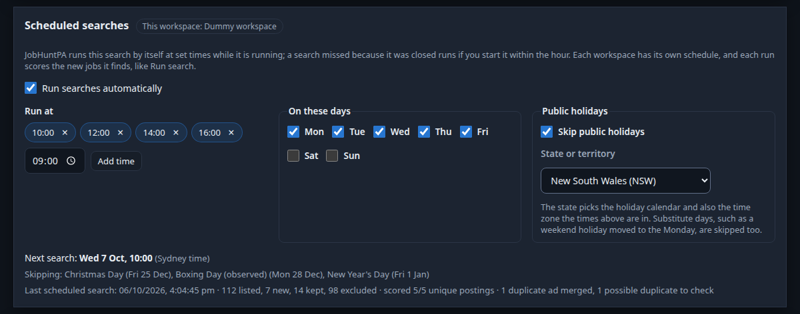

- **Tracking and tidying**: set each job's status (to review, shortlisted, applied, interviewing,
  rejected, not interested). Tick jobs, or filter the list and tick **Select all shown**, to change
  status or **Hide** them in bulk (only jobs on screen are ever affected); hidden jobs stay hidden when a search finds them again, aren't scored or
  researched, and come back with *Show hidden*.
- **Softening the office-days rule**: if you set a maximum number of office days for hybrid roles,
  the Jobs tab's **Office days (temporary)** menu lets you allow extra days (up to 5) for now. Jobs that
  only that rule excluded reappear, marked *shown by temporary +N office days*, and **Score them**
  scores any that were never scored. Nothing is saved: *Back to my rule*, reloading the page or
  switching workspace restores your saved limit.
- **Government jobs**: Australian Public Service jobs come from APSJobs. Add a source such as
  `https://www.apsjobs.gov.au/s/job-search?department=Services%20Australia` (the agency name as
  APSJobs lists it) or `...?searchString=product%20manager` for a search across all agencies.
  Careers pages that publish an RSS feed (e.g. SBS) can be added by the feed's URL.
- **Shared job pool**: every job any search finds is stored once and shared by all workspaces, so
  an ad's full page is fetched only once. Each search also brings in jobs that other searches
  already found, if they match your own job titles or include keywords and pass your filters
  (dealbreakers, salary, work mode, pins). A workspace with no titles or keywords gets none.
  Everything you do with a job stays with your workspace: status, hidden, why it's excluded, score,
  office, location call, cover letter and chats.
- **Closed jobs**: a job counts as closed when its page is gone, when its employer's complete job
  list no longer has it, or when no search has listed it for 45 days (how SEEK jobs close, since
  SEEK results are only the first page). A closed job that is listed again reopens. Jobs missing
  from one search's results aren't closed: another search may still list them.
- **Full SEEK ads**: SEEK jobs marked *summary only* have an **Upload full ad** button. Save the
  ad's page from SEEK in your browser and upload it to score the job on the whole ad. The full ad
  you upload stays private to your workspace: other workspaces with the same job keep seeing SEEK's
  summary. Jobs from pages you import (*Search setup → Import saved pages*) are private too,
  unless a search has already found them.
- **Company info** (ⓘ next to the employer, and the job page): what company research found
  (business, ownership, offices, employee reviews and news) is shared by all workspaces, so a
  company is researched once. **Fill missing info** researches companies with no profile yet, or one
  older than 30 days. **Research again** in a company's profile refreshes the employee reviews and
  the news when they're more than a day old and keeps the rest; if everything is recent, it shows
  the saved profile without asking the AI again. A profile older than 30 days is researched in full.
- **Suggested job titles** (Documents tab): the AI reads your documents and suggests titles to
  search for; add them to the current search or start a new workspace with them.
- **Notes** (Documents tab): under *Write a note*, give a note a title, type its text, pick a
  type and click **Save note**. Use notes for things that aren't in your CV, such as a project you
  led, or what you want from your next job. A note works like an uploaded document: tick or untick
  *use for scoring*, **Open** it to edit its text, title or type, or **Delete** it. Notes are
  plain text and are stored only in JobHuntPA.
- **Preferences** (a document type for uploads and notes, shown as *Preferences (private)*): say
  what you want from a job, such as the commute you'll accept or work you want to avoid. The AI uses
  them when scoring jobs (it names jobs that conflict with them), in job chat and in suggested job
  titles. They are never treated as experience, and they are never sent when drafting cover letters.
- **Concise versions**: **Open** a document and use *Create concise version* to have the AI write a
  shorter version of it. Read it against the original and edit it, then *Save concise version*.
  *Write it again* replaces it. Choose whether the AI gets *the original* or *the concise
  version*. Switching, or editing the version in use, marks existing scores as out of date, so
  they're recalculated with the new text. For an uploaded file, only the concise version can be edited.
- **Summary of your documents**: *Create summary of ticked documents* merges every ticked document
  (not preferences) into one new document, with each fact once and every employer, date, number and
  qualification kept. It takes a few minutes. The summary opens so you can read and edit it. Once
  you're happy, click *Untick the originals* so the same facts aren't sent twice (or *Keep both ticked*).
- **What documents cost**: your ticked documents are sent to the AI with every job it scores and
  every chat question, so long ones add up. JobHuntPA asks providers to cache them so repeats cost
  less. For Claude (directly or through OpenRouter) it marks the documents for caching; for
  OpenAI, Meta and Mistral it sends a cache key. OpenAI, Meta, xAI, Gemini, DeepSeek, Groq and OpenRouter's other
  models cache on their own, and Ollama runs on your computer. Either way the documents are still
  sent each time; caching only makes a repeat cheaper and faster. Concise versions and a summary
  cut the size, and with it the cost.
- **Cover letters**: *Draft cover letter* on any job writes a first draft from your documents
  (upload earlier cover letters as "Cover letter" documents to match your style). Edit it, then
  copy it or download it as a Word file. Always check it before sending.
- **Chat about jobs**: *Chat* on a job (or tick several and click **Chat about N jobs**) opens a
  chat on the right. The AI sees the ads, your documents, the fit assessment, the company info and
  any cover-letter draft, so you can ask what the role really involves, how to handle your gaps,
  what to ask in an interview, or which of several jobs suits you best. Tick *Search the web* for
  things your saved data doesn't cover (news, salaries); the pages it used are listed under the
  answer. Chats are saved per job set; *New chat* starts over.
- **Duplicate ads**: the same job advertised on several sites (say SEEK and the employer's own
  careers page) becomes one card, with the other sites under *Also on*. The app merges ads it's
  sure about after each search and lists the doubtful ones under **Duplicates** for you to decide
  (*Same job: merge* / *Different jobs*). Your status, cover letter and score carry over to the
  merged card. *split* under *Also on* undoes a merge; **Merge as one job** (tick two or more
  jobs) merges ads the app missed.
- **Job page**: *Open ↗* on a job opens it in a new tab: the whole ad, the fit and gaps, a map of
  the office, the company profile, and the commute there and back at peak times (arriving by 9:00,
  leaving at 17:00 on a Tuesday; change these under Search setup > Commute). Public transport is
  planned from the stations you list there (e.g. Hornsby Station, Asquith Station), including
  changes, metro, buses and walking at the other end; driving starts at your home pin. See
  [Commute times](#commute-times-optional) for the two free keys this needs.
- **Map**: two modes. **Jobs** shows the jobs your Jobs tab filters show, with your pins and their
  radii, and lists the jobs in view under the map (click a dot, or **Show** in the list, to see a
  place's jobs; **Open ↗** for a job's full page in a new tab); nothing can be changed by accident.
  **Edit pins** drops a pin where you click or tap (drag to move). Without a mouse, move the map
  (arrow keys) until the cross in its middle is on the place and press **Drop a pin at the cross**;
  **Move to the cross** in the pin list moves a pin there. *Only list pins in view* shortens the
  pin list to the area on screen.
- **Office locations**: most ads only say "Sydney NSW", or an area such as "North West & Hills District"
  (placed at its main centre, here Castle Hill, for the location filter). Instead of trusting that, such jobs show
  **office unknown** until the office is found: the scorer reads it from the full ad, and company
  research (**Fill missing info**) finds the employer's office addresses. An office named in the ad
  wins; otherwise, with several offices in that city, the one closest to your commute pins is used
  (you can pick another on the job page). Recruitment agencies rarely name the client, so their ads are left to you: on the job
  page set the office (address or suburb, or one of the employer's offices), or make the call with
  **Location OK** / **Too far**. The office then drives the location filter and distance.
- **Themes** (Settings > Theme, saved with your account and remembered by the browser): each theme is a card with a small live
  preview of the app in it; click or tap one, or move through them with the arrow keys, and it
  applies at once (open job pages follow). Dark (the default), Light, or *System* to follow your
  computer; Catppuccin (Latte, Frappé, Macchiato, Mocha); Rosé Pine (Rosé Pine, Moon, Dawn); Nord
  (dark, and a light variant made from Nord's colours); Kanagawa (Wave, Dragon, Lotus); Everforest
  (dark and light, medium contrast); a **Dyslexia** theme (warm low-glare background, Atkinson
  Hyperlegible font, wider letter and word spacing) in light and dark; and colour-vision themes
  (Protanomaly, Deuteranomaly, Tritanomaly, Dichromacy, Monochromacy), each in light and dark. The
  family themes use their projects' official palettes; where a colour fell short of the WCAG AA
  contrast minimums it is a little lighter or darker in the same hue (themes.css lists each change).
  Labels, marks or shapes always accompany colours, so nothing relies on colour alone. See
  [Accessibility](#accessibility).
- **Reasoning level** (admin panel > Server): how long the AI thinks, set separately for scoring,
  cover letters, company research and job chat. *Detect supported levels* shows what your model accepts.

## Ghost jobs

Some ads stay up when nobody is being hired: a "talent pool" ad that collects applications for later, a
role posted again and again, an ad left open for months. JobHuntPA can't know, so it shows **signs** and a
rating made from them, and never hides, scores or ranks a job down because of them.

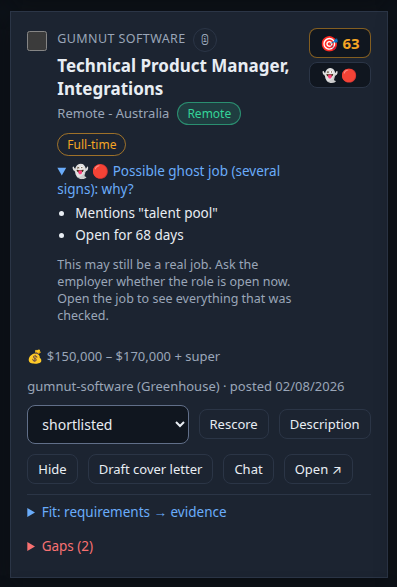

- **The circle:** under its fit score (🎯), every job card, the map list and the job page show 👻 and a
  coloured circle:
  - 🟢 no signs, or only one or two weak ones;
  - 🟡 some signs: the card adds **Possible ghost job (some signs): why?**, which lists them;
  - 🔴 one strong sign, or several moderate ones (**several signs**).

  Hover over the circle to read the signs that were found. It is a rating from the signs, not a measurement:
  the app puts no number on it.
- **Why this rating:** open the job. **Is this a real vacancy?** lists every kind of sign and says whether it
  was found (and how strong it is), not found, or could not be checked (the company hasn't been researched, or
  the job didn't come from a search and has no listing history), what the colours mean and, for a flagged job,
  what to ask the employer. These are signs only and can be wrong: it may be a real job.
- **The signs:**
  - the ad has been open for 45 days or more (the longer, the stronger);
  - the same role from the employer was listed before, ended and was listed again;
  - the posted date was renewed while the ad stayed listed;
  - wording such as "talent pool", "talent community" or "register your interest";
  - five or more open ads for the same role at one company;
  - a recruiter's ad that may not name the employer;
  - recent news of job cuts at the company (from company research);
  - the AI's reading of the ad, when it finds wording that says the job isn't a current vacancy (it can be
    wrong, and alone it is never "several signs").
- **Hiding them:** tick **Hide possible ghost jobs** in the filters (off by default; it hides the yellow and
  red ones, and the count says how many it hid). Digest emails add a "Possible ghost job" line to a flagged job, and the data export lists the signs.

## Adding company careers pages

SEEK has most jobs, but many employers also (or only) advertise on their own careers page. Add
those under **Search setup > Company sources**, once per workspace:

1. Find the company's page that **lists** its open jobs (usually behind "Careers", "Join us" or
   "Open roles"): the list, not a single ad.
2. Paste its address into **Careers page URL**, type the company's name if you like (shown on its
   jobs when the page doesn't say), and click **Add**.
3. Click **Test**. It shows what the app finds without saving anything: how many jobs, how it read
   them and a few titles. It can take a minute, because the app waits between requests to a site.
4. From now on, **Run search** and the scheduled searches collect its jobs. Untick a source to
   skip it for a while; **Delete** removes it (its jobs stay in your list).

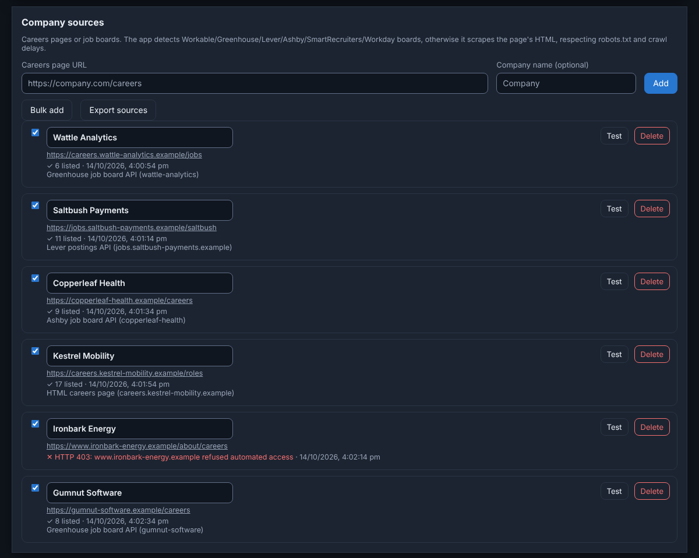

**Which address to use.** Many companies run their jobs on a hosted job board. The app reads
those boards' own job feeds, which is quick and complete, so if a careers page links to one, the
board's address works best (the careers page itself usually works too, as the app follows the link):

| Job board | Address looks like |
| --- | --- |
| Workable | `https://apply.workable.com/company/` |
| Greenhouse | `https://job-boards.greenhouse.io/company` |
| Lever | `https://jobs.lever.co/company` |
| Ashby | `https://jobs.ashbyhq.com/company` |
| SmartRecruiters | `https://jobs.smartrecruiters.com/Company` |
| Workday | `https://company.wd3.myworkdayjobs.com/en-US/Careers` |

Any other careers page works if its jobs are on the page or one click away: the app reads the job
data many sites embed for search engines, or else follows the links to each ad (and "next page"
links), and opens pages that only appear in a real browser in a hidden one. A job feed (RSS)
can be added by its address, and for government jobs add an APSJobs search (see *Government
jobs* above).

**When a source doesn't work**, its last result in the list (and **Test**) says why:

- *refused automated access* or *answered with a bot check*: the site blocks tools like this one.
  JobHuntPA never gets around that; look for the company's job board link instead, or check the
  site yourself now and then.
- *robots.txt disallows ...*: the site asks automated tools to stay out of that page, and the
  app respects it.
- *no job postings found*: check you added the page with the list of jobs. Some sites only show
  the list after you search: open it in your browser, click *Search* or *View all jobs*, and add the
  address you end up on.

Each source brings in at most 60 new full ads per search; the rest follow on the next search.

## Browser extension

The JobHuntPA extension for **Chrome** or **Firefox** adds the page in your current tab to JobHuntPA:

- **Add as a job**: the extension reads the ad you are looking at, shows what it found (title, employer,
  location, salary, employment type, work mode, description) so you can correct it, and saves it as your own
  job in the workspace you pick, like an imported page. It reads the page in your own browser, on your own
  machine, so ads behind a sign-in work too, and it sends JobHuntPA only the job: those values and the
  description as plain text. The page itself (its HTML, the rest of its text, anything else you are signed in
  to) never leaves your browser. Select the ad's text first to use only that as the description. A job you
  already have (the same address) is brought up to date instead of added twice, and the popup tells you before
  you save. If your filters leave the saved job out of the Jobs list (for example a location or keyword you
  excluded), JobHuntPA tells the extension why; tick **Show excluded** in the Jobs tab to see it.
- **Jobs on this page**: on a SEEK search results page the popup lists every job on the page with a tick
  box and adds the ticked ones in one go. It works on whichever view you have open in your own, signed-in
  browser: *New to you*, sorted by date, page 2 and beyond, which JobHuntPA's own SEEK search can't reach
  (it gets the first page of each search, in SEEK's order). Jobs SEEK marks as new to you are ticked to start
  with; **Tick all** takes the whole page. Each job is added from the summary on its card (title, employer,
  location, salary, work type, classification, the short description and the date it was listed, to the
  day), as JobHuntPA's own SEEK search stores it; for the full ad, open the job on SEEK and use **Add as a
  job**, or **Upload full ad** on its card. This only ever adds: a job you already have is left exactly as it is,
  so going over a page twice does no harm, and the popup says for each job whether it was added or was
  already there. You move to the next page yourself and press the button again. The extension reads only
  the page you have open; it never clicks, scrolls or opens anything on SEEK. Needs version 1.1 of the
  extension.
- **Add as a company source**: adds the page as a [careers page](#adding-company-careers-pages) of the
  workspace, and **Test** shows what a search would find on it.

To connect it:

1. Install the extension: [for Chrome](https://github.com/florian3706/JobHuntPA-chrome-extension) or
   [for Firefox](https://github.com/florian3706/JobHuntPA-firefox-extension) (each page says how).
2. In JobHuntPA, open **Settings > Browser extension**, type a name such as "Firefox on my laptop" and click
   **Connect a browser extension** (it may ask for your password).
3. Copy the **server address** and the **extension key** it shows into the extension's options, then pick a
   workspace. The key is shown only once. Keep it secret: like a signed-in browser, it opens your data.

The card lists your connected extensions with when each was last used. **Disconnect** stops a key at once.
A key also stops working after 60 days without use, a year after it was made, and whenever your account is
signed out everywhere: *Sign out everywhere else*, a password change that signs out the other devices, a
password reset, and an admin turning your account off. Then connect the extension again. A key can only add
jobs and company sources and list your workspaces and sources: it can't read your jobs, documents or
settings, or change your account.

The extension sends its key as `Authorization: Bearer jhpa_...`. If JobHuntPA sits behind a sign-in proxy
(oauth2-proxy, Authelia and the like) that passes its own `Authorization` header on, JobHuntPA ignores that
header and your browser's sign-in works as usual.

## Updating

- **Windows:** download the newest JobHuntPA-Setup.exe and run it again with the same folder.
- **macOS/Linux:** download the new ZIP and copy its contents over your folder (or `git pull`),
  then run setup again.

Your settings, documents, jobs and API key are kept. Keep `data/server-keys.json` with your database
when you copy or back up either.

### Updating from an older version

These happen once, on the first start after you update from a version before the feature named.

**Accounts.** The first start opens the page that creates your
account (see [Your account](#your-account)): it becomes the admin, and all your existing
workspaces, jobs, documents and settings move into it. Until then JobHuntPA shows nothing else and
scheduled searches wait. It also creates `data/server-keys.json`, the server's key file: it belongs
with your database, so back them up together.

**Encrypting your existing data.** The first time the admin signs in (or right away, on the first-run
page), JobHuntPA encrypts everything from before with the admin's key:

1. It saves a backup first, `data/jobhunt.db.bak-before-encryption` (unencrypted, with the keys from
   before). Delete it once you're sure you don't need to go back.
2. It encrypts your uploaded files, then your data, in small steps. A few thousand jobs take seconds
   on a computer and up to a minute or two on a Raspberry Pi. Meanwhile the dashboard shows the
   progress and reloads by itself when it's done. If JobHuntPA is stopped halfway, it carries on the
   next time the admin signs in; nothing is lost or encrypted twice.
3. It checks that nothing is left unencrypted, then rebuilds the database file so the old
   unencrypted pages are gone.

Afterwards the dashboard shows admins a notice that links to the admin panel's **Server** section.
Its "Unencrypted copies of data" part lists the files that still hold your data unencrypted (that
backup, older `data/jobhunt.db.bak-*` backups and the `data/cache` pages of an earlier version) with
**Delete these files now**, which asks for your password, until they're gone. Keep the backup only if you might go back to an older
version: **older versions can't read the encrypted database**. To go back, stop JobHuntPA, install
the older version, and replace `data/jobhunt.db` with the backup (delete `data/jobhunt.db-wal` and
`data/jobhunt.db-shm` too); anything you did since the update is lost.

**The shared job pool.** The first start moves your jobs into it. This takes a few seconds; a backup is saved first as
`data/jobhunt.db.bak-before-job-pool`. Copies of the same ad in different workspaces become one
shared job, and each workspace keeps its own status, scores, cover letters and chats. Full SEEK ads
you uploaded stay private to their workspace. SEEK jobs that no search has listed for 45 days now
show as closed.

## Changing your AI provider or key

Only the admin account can see or change these; they apply to everyone. Open the **admin panel** (Account > Admin), **Server > AI provider**: pick the provider (it fills in the API address and suggests models),
choose the model, paste your key and click **Save**. It takes effect straight away; click
**Detect supported levels** afterwards, as each model offers different reasoning levels, and
**Test connection** to check the key. The key is saved in the `.env` file in the app folder and
is never shown again in full. Changing to a provider at a different address needs the key again,
so a saved key can't be sent anywhere new.

You can also run setup again with `--reconfigure` (macOS/Linux: `./setup.sh --reconfigure`), or
edit `LLM_API_KEY`, `LLM_BASE_URL` and `LLM_MODEL` in `.env` and restart the app.

## Commute times (optional)

The commute on each job's page uses two free services. The admin adds their keys in the admin panel under **Server > Commute data** (they work straight away for everyone; **Test saved keys** checks them), or when setup
asks, or in `.env` followed by a restart:

- `TFNSW_API_KEY`: public transport in NSW. Sign up at https://opendata.transport.nsw.gov.au,
  create an application, and copy its API key. Without it the page shows driving only.
- `TOMTOM_API_KEY`: driving times with peak-hour traffic. Sign up at
  https://developer.tomtom.com and copy the default key. Without it, driving times come from
  OSRM's public server and ignore traffic (the page says so).

## Uninstalling

Close JobHuntPA first, then:

- **Windows:** *Settings > Apps > Installed apps > JobHuntPA > Uninstall*, or the Start-menu
  shortcut **Uninstall JobHuntPA**.
- **macOS:** double-click **`Uninstall JobHuntPA.command`** in the app folder (right-click > Open
  the first time).
- **Linux:** run `./uninstall.sh` in the app folder.

The uninstaller first offers to save a **backup** (your jobs, documents, workspaces, accounts,
settings, API keys and the server's key file `data/server-keys.json`) as
`JobHuntPA-backup-<date>.zip` in your Documents folder, readable only by you. Keep it private. It
then removes the shortcuts and the app folder. It asks before removing the shared browser
component, and leaves Python installed because other programs may use it. To restore a backup,
install JobHuntPA again and unzip the backup into the new app folder: the database and
`data/server-keys.json` must stay together, and you still sign in with your password.

## Troubleshooting

- **The browser shows nothing:** check the JobHuntPA window for error messages. If it says
  another copy is running, use that one, or restart your computer.
- **"LLM not configured" in the app:** your API settings are missing; see *Changing your AI
  provider or key*. Accounts other than the admin see "AI not set up": the admin sets it.
- **The first-run page says the setup code isn't right:** close JobHuntPA and start it again; it
  prints a fresh link, and the code is in `data/first-run.txt`. The code only works until the first
  account exists; after that, sign in instead.
- **Forgotten password:** see [Signing in](#signing-in): a recovery code sets a new password and keeps your
  data. Without your password or a recovery code, your encrypted data can't be read, by you, the admin or
  anyone else.
- **"Too many sign-in attempts from this network. Try again in 5 minutes":** one network address is held to 10
  sign-in requests in 5 minutes; wait, then try again. After wrong passwords, the wait is per place and
  grows up to 15 minutes (an admin can unlock you). Restarting JobHuntPA clears the counts.
- **The page says "This address isn't allowed":** JobHuntPA was reached by a name it doesn't know. Open it
  by its IP address or `localhost` (the address it printed when it started), or add the name you use to
  `JOBHUNT_ALLOWED_HOSTS` in `.env` (or set the public address in Admin > Server > Email), then restart
  JobHuntPA. The message names the address that was refused, and the JobHuntPA window logs it once. See
  [Reaching JobHuntPA from other devices and addresses](#reaching-jobhuntpa-from-other-devices-and-addresses).
- **"Email isn't set up on this JobHuntPA yet":** an admin sets it up in **Admin > Server > Email**: the mail
  server, the From address and the public address. Until then, use a recovery code on the sign-in page.
- **No "Email me a link" on the sign-in page:** it shows only once email is set up (see above).
- **The test email fails** ("The mail server refused it" and a name such as `SMTPAuthenticationError`): check the
  server, port and encryption (587 with STARTTLS, or 465 with SSL), the user name and the password. Gmail and
  many others need an *app password*, not your usual one. Nothing else is shown, so no password or address
  leaks into a log; the JobHuntPA window names the kind of failure.
- **The reset or confirmation email never arrives:** look in spam, and check the From address's SPF and DKIM
  records. Asking again many times in a row is limited (3 an hour per address); the page answers the same either
  way. If every earlier link has run out, a new request always goes out. A link works once and for 1 hour (confirmation links: 24 hours); only the newest link works.
- **The reset page says the link has expired or was already used:** ask for a new one on the sign-in page. It
  can't say which, so nobody can use it to find out who has an account.
- **No job digest arrives:** open Settings > **Job digest emails**. If something is missing it is listed there
  (email not set up, address not confirmed, Background access off, no membership). Otherwise check that the
  switch is on, that scheduled searches have run since you turned it on (only jobs found after that are
  sent), that it is past 07:00 on a day it is due, and the spam folder. If the mail server fails, JobHuntPA
  tries again a few minutes later.
- **The reset page says my data will be deleted:** background access is off for that account, so the saved data
  is locked with the old password. A recovery code keeps it (*I have a recovery code*); otherwise tick the box
  to start again with an empty account (see [Signing in](#signing-in)).
- **Memberships don't switch on:** Stripe has no active price with the right lookup key. In the Stripe
  dashboard check that the price's **lookup key** is `jobhunt_monthly` (or the one set in the Payments (Stripe)
  card) and that you are in the same mode (test or live) as the key you pasted, then press **Sync now** in the card.
- **"AI features are for members" although I still have free searches:** that is the rule: a free search finds and
  scores jobs, and the other AI features need a membership (or an admin's free period).
- **"You have used your free searches" (or "Scheduled searches need a membership") although I paid:** open
  **Account > Membership**. It asks Stripe again and updates your status; if you paid a moment ago and it still
  says no, wait a minute and reload.
- **"Download your data" is refused:** over 200 MB the zip is too big to make in one go (delete uploaded files you
  no longer need), "other exports are being made" means try again in a minute, and "still being made" means your
  last request hasn't finished or its download is still going: wait for it (a download that has not finished after 10 minutes, plus the time the zip needs at 100 KB/s, is cut off).
- **Lost your authenticator app:** sign in with a recovery code instead of the app's code, then turn
  two-step sign-in off and on again in Settings > Two-step sign-in. (An admin can also turn it off for you.)
- **The last admin lost their password and every recovery code:** people can still sign in, but
  admins can't read names and email addresses any more ("Details unavailable until this person
  signs in"). Stop JobHuntPA and run `python -m backend.keys new-admin-key --email you@example.com`
  (in the app folder, with the app's Python: `.venv/bin/python` on macOS and Linux, `.venv\Scripts\python` on Windows). That account
  becomes an admin with a new admin key; everyone's details are re-sealed to it when they next
  sign in (at once for people with background access).
- **"JobHuntPA is waiting for its admin to sign in, to finish encrypting the data":** the one-time
  encryption after an update needs the first admin's password; it carries on when they sign in.
- **"Encrypting your data stopped (...)":** JobHuntPA tries again a minute later and whenever the
  admin signs in. If it keeps stopping, the JobHuntPA window says why; your data is safe meanwhile,
  and the backup `data/jobhunt.db.bak-before-encryption` was saved before anything changed.
- **JobHuntPA stops at start-up with "Restore data/server-keys.json from your backup":** the key file
  is missing or isn't the one that belongs to this database. Put back the `data/server-keys.json`
  from the same backup as the database. A new key file is never made while accounts exist.
- **The key file is lost and there is no backup:** nobody can sign in, because email addresses are
  found through that file. With JobHuntPA stopped (the command refuses while it is running), an active
  admin can make a new one: run
  `.venv/bin/python -m backend.keys recover-lost --admin-email you@example.com` (on Windows,
  `.venv\Scripts\python -m backend.keys ...`) from the JobHuntPA folder and type that admin's
  password when asked. It writes a new `data/server-keys.json` and works out every account's email
  lookup again, so everyone signs in as before and **keeps their data**. What everyone must then
  redo: **turn background access on again** (Settings > Background access; until then scheduled
  searches are skipped) and, if they used it, **set up two-step sign-in again**. If it says some
  accounts "could not be worked out", those accounts can't sign in until the original key file is
  back. Then back up the new file with the database.
- **Some company sites return no jobs:** they may block automated access or need the browser
  component; setup's step 3 installs it. On Linux you can fix a failed browser install with
  `.venv/bin/python -m playwright install --with-deps chromium`.

## Accessibility

JobHuntPA aims to meet **WCAG 2.2 level AA** in every theme, in desktop and phone browsers.

- **Keyboard:** everything works without a mouse. *Skip to main content* is the first thing Tab
  reaches; the tabs move with the arrow keys; dialogs keep focus inside, close with Escape and
  return focus to the button that opened them; focus is always visible and never hidden under the
  sticky header. The map has keyboard routes for everything: the list under it (**Show** opens a
  place's jobs), and in pin mode **Drop a pin at the cross** and **Move to the cross** instead of
  clicking and dragging. The theme picker is a radio group: arrow keys move through the themes.
- **Screen readers:** landmarks, one heading outline, labels on every field, and spoken status
  messages for searches, scoring, saves and errors. Form errors appear under the field they belong
  to and say how to fix it.
- **Colour:** every theme meets 4.5:1 for text and 3:1 for field borders, the focus ring and
  selected states (`tools/theme_contrast.py` checks 71 colour pairs per theme). Nothing is told by
  colour alone: scores are numbers, statuses and work modes are words, excluded jobs on the map are
  hollow dashed dots, the pin kinds have solid, dashed and dotted rings, and messages carry a mark.
- **Phones and zoom:** the app works from 320 px wide, at 200% zoom and with wider text spacing
  without sideways scrolling; wide tables turn into stacked rows; the header only sticks where
  there's room; touch screens get 44 px controls and 16 px text in fields (no zooming on iPhone).
- **Motion:** with *reduce motion* set on the device, spinners, progress bars and map animations
  stop.

**How it was tested** (October 2026, `tools/a11y_audit.py`, see [For developers](#for-developers)):
[axe-core](https://github.com/dequelabs/axe-core) 4.14 with the WCAG 2.0, 2.1 and 2.2 A and AA rules, in
headless Chromium (Playwright), on every page and every state of it: the dashboard's tabs, cards and
dialogs, the job page, the sign-in, first-run, recover, sign-up, reset, confirm-email, billing, admin and
unsubscribe pages, each step of the walkthrough, at 320 and 1280 px wide in the Light, Dark, Dyslexia and
Deuteranomaly themes (the colour contrast rule also in all 28 themes): no violations. The same run
checked reflow at 320 px and WCAG's text spacing, watched the console (no errors, no
Content-Security-Policy violations) and pressed Tab through the main flows (sign in with a code, the
walkthrough, change password, two-step setup, a job's status, the admin people table and its dialogs, the
data export) and through every page: a visible focus ring on every stop, none hidden, no traps, focus back
where it came from after a dialog, Escape closing it. `tests/test_accessibility.py` keeps the contrast and
the pages' basics (language, viewport, skip link, headings, labels) checked on every test run.

**Known limitations:**
- Not yet tried with real screen readers (NVDA, JAWS, VoiceOver, TalkBack) or by disabled users: the
  checks above are automated, plus a review of the code.
- The map tiles are OpenStreetMap's own pictures and stay light in every theme; street names on them
  are outside the app's control. The job dots on the map aren't keyboard stops, and a pin can't be
  dragged with the keyboard: the lists under the map are the keyboard route (Show, Drop a pin at the
  cross, Delete). Two pins dropped on the same spot sit on top of each other on the map, so their
  markers are smaller than 24 px targets where they overlap; the same list reaches each of them.
  Panning the map takes a drag, the arrow keys, or the zoom buttons and a double-click.
- Text from elsewhere (job ads, company research, AI answers) is shown as it comes.
- Messages in the corner disappear after a few seconds; they wait while the pointer or focus is on
  them, have a Dismiss button, and screen readers announce them.
- In Chrome on Windows, the arrow keys change a closed drop-down at once, so arrowing through the
  Workspace menu switches workspace at each step: open it first (Alt+Down).
- The colour-vision themes' colours were simulated for colour vision deficiencies in ProjectTimeline;
  the small lightness changes made here for contrast keep their hues but weren't simulated again.

## For developers

Setup lives in one place, `installer/installer.py` (standard library only), called by `setup.sh`
(Linux/macOS) and by `JobHuntPA-Setup.exe` (`installer/windows_setup.py`). Removal is
`installer/uninstaller.py`, called by `uninstall.sh` and built into `JobHuntPA-Uninstall.exe`. Starting goes through
`installer/launch.py`, called by `start.sh` and `JobHuntPA.exe` (`installer/windows_launch.py`).
**Any change to dependencies, configuration, data folders or how the app starts must update
these scripts**; `.github/workflows/ci.yml` runs the real setup and launch on Linux, macOS and
Windows on every push to catch breakage.

Manual run: `python3 -m venv .venv && .venv/bin/pip install -r requirements.txt`, copy
`.env.example` to `.env`, then `.venv/bin/python installer/launch.py`. Tests:
`python3 -m unittest discover -s tests -t .`

**Accounts in development and CI:** `JOBHUNT_ADMIN_EMAIL` and `JOBHUNT_ADMIN_PASSWORD` in the process
environment (not `.env`) create the first admin at start-up, which is how CI signs in
(`/api/auth/login`, then the session cookie). Every `/api` route needs a session except
`/api/health` and the sign-in endpoints; POST, PUT, PATCH and DELETE also need the page's
`X-CSRF-Token` (from `/api/auth/me`) and must not come from another site. The tests run on a throwaway
database, `.env` and key file, with `JOBHUNT_TESTING=1` and the fast `JOBHUNT_KDF_PROFILE=test`
(tests/__init__.py); `tests/helpers.py` gives signed-in clients (`with helpers.client() as c:`),
other accounts (`helpers.make_user()`) and the admin's key scope (`helpers.as_admin()`). Code and the
design notes: `backend/users.py` (accounts, first run, deleting an account), `backend/sessions.py`
(sessions, CSRF, the checks on every request), `backend/auth.py` (signing in, sign-up, the two-step code,
resetting with a recovery code), `backend/security.py` (password, two-step setup, recovery codes, other
sessions), `backend/totp.py` (authenticator codes), `backend/admin.py` (the admin panel's API) with
`backend/admin_key.py` (the admin key: grants, replacing it, healing details), `backend/signup.py` and
`backend/tokens.py` (sign-up modes and invitations), `backend/key_rotation.py` (the server key),
`backend/background.py` (background access), `backend/key_recovery.py` (the `recover-lost` command),
`backend/export.py` (data export), `backend/account.py` (preferences, the walkthrough step, deleting
an account), `backend/extension.py` (the browser extensions' API and keys; the extensions read the page themselves and
send only the job, or the jobs listed on a page of search results), `docs/design/accounts.md`. `python -m backend.keys` has `bench-kdf`, `rotate-kek`,
`new-admin-key` and `recover-lost`. The pages' scripts beyond the dashboard's: `frontend/account.js`
(account cards), `account-email.js` and `email-settings.js` (email address and server settings), `background.js`,
`extension.js` (Settings > Browser extension),
`export.js`, `admin.js`, `server-settings.js` and `stripe-settings.js` (the admin panel), `dialogs.js` (its
dialogs), `signup.js`, `forgot.js`, `reset-password.js` and `verify-email.js` (the link pages), `billing.js`
(`billing.html`, Account > Membership) and `free-searches.js` (the Jobs tab's free-search note).

**Hardening** (design §2.5 and §18): `backend/hosts.py` (the Host allowlist: 400 before anything else runs) and
`backend/security_headers.py` (the Content-Security-Policy, built at start-up from the pages, with a hash for each
inline script; `nosniff`, `Referrer-Policy: same-origin`, `Permissions-Policy`, and HSTS over HTTPS) wrap the whole
app (`install_security_headers` in `backend/app.py`). The policy allows no inline styles or event handlers, so
**don't write `style="..."`, `onclick="..."` or `<style>` in a page or in markup a script builds**: use a class
(`.hue-*` in `styles.css` set a colour slot), `addEventListener`, or `element.style.x = ...`. A new script or
stylesheet from another site, or a second inline script, must be added to `backend/security_headers.py`;
`tests/test_security_headers.py` fails until it is. `QUIET_LOGGERS` and `SqlAtWarning` in `backend/app.py` keep
libraries that log a person's data (httpx, the Claude SDK, pypdf, SQLAlchemy's rows) out of the logs at any level;
`tests/test_log_leaks.py` is the end-to-end check, so add a step to it when a feature handles personal text.
`/docs`, `/redoc` and `/openapi.json` are off. Every new endpoint decides who may call it (open, signed in,
admin, a recent sign-in, a membership) and gets a test that says so.

**Email** (design §9, §16): `backend/mailer.py` (SMTP, never logs an address) and `backend/email_templates.py`
(HTML and text parts); `backend/mail_queue.py` sends from one background thread and says whether email is on
(`enabled`: SMTP and the public address are set); `backend/email_settings.py` (the admin's settings and test
email, `/api/settings/email`), `backend/account_email.py` (address checks, changing the address, security
notices), `backend/password_reset.py` (forgot, reset). Links that give access carry the token in the URL fragment
(`reset-password.html#token=…`, `verify-email.html#token=…`). Tests mock SMTP with `mailer.capture()` and wait for the
thread with `mail_queue.drain()` (`tests/mail_helpers.py`). `backend/digest.py` builds and sends the job digests (design §17).
`backend/schedule.py`'s loop also clears expired sessions and links every 10 minutes (`auth.cleanup_tick`; off with
`JOBHUNT_SCHEDULER=off`).

**Memberships** (design §8): `backend/access.py` (pure decisions: who has access and why, no database or
network), `backend/billing.py` (the only module that talks to Stripe, through the official SDK),
`backend/membership.py` (the gate every paid endpoint depends on, free searches, `/api/billing/*` and the webhook).
`backend/schedule.py` also syncs subscriptions with Stripe every 6 hours. Stripe is mocked in tests by patching
`backend.billing._client` with a `MagicMock` (`tests/test_membership.py`, `tests/test_billing.py` show the shapes
Stripe answers with); nothing in the tests reaches the network.

**Ghost jobs** (`docs/design/ghost-jobs.md`): `backend/ghost.py` turns facts about a posting into signs and a level, and for the job page lists every check and
how it came out. The pages show the level as a coloured circle (`ghostMeter` in `frontend/common.js`).
The ad's own wording is worked out when a posting changes (`ghost.stamp`, called by `backend/pool.py`), the pool's
history at the end of a search run (`ghost.refresh`), and the rest when a job is read (`ghost.assess_jobs`, used by
the job list, the job page, the digest and the export). It reads only public ads in Python and never filters or sorts
on a sealed column. Tests: `tests/test_ghost.py`.

**Encrypted columns** (`backend/crypto.py`, `docs/design/accounts.md` §2): personal columns use the
`Sealed*` types, which encrypt under the key of the request's account (or the background run's). The
rules:
- Never filter, sort, group, `DISTINCT` or run an SQL function on a sealed column: the comparator
  refuses comparisons when the query is built, and a compile hook refuses the rest
  (`SealedSqlError`). Decide in Python, or compare a blind index (`jobs.url_index`,
  `company_sources.careers_url_index`). `SealedAlways` columns (`jobs.hidden`, `excluded_reason`,
  the office override, a job's own content) can't even be tested for NULL.
- Check ownership through the plaintext `workspace_id` before loading a row (`workspaces.owned`);
  a row sealed under another account's key raises `KeyMismatch`, which the API answers with 404.
- Thread pools start work with `backend.threads.submit` (or `crypto.submit`), which carries the key
  scope into the worker; a plain `pool.submit` raises `crypto.Locked`.
- Write migrations of sealed columns with Core `update()`, never raw SQL text: after the one-time
  encryption (`backend/migrate_encryption.py`) strict mode refuses plaintext in a sealed column.
- Never log user data.

`JOBHUNT_DATA_DIR` moves the whole data folder (uploads included); tests and tools point it at a
throwaway folder, so they never touch `data/`. `python3 tools/bench_jobs_list.py` times the job list
on 5,000 made-up encrypted jobs in such a folder (target: under 1.5 s on a Raspberry Pi 4; run it on
the Pi to check there).

**README screenshots:** `python3 tools/readme_screenshots.py` (needs `pip install pillow`) builds a
throwaway database of made-up data with `tools/demo_data.py`, runs the app on it with fake AI
settings and no scheduler, and saves `docs/screenshots/*.png`. It never touches `data/` or `.env`.
Re-run it after changing the UI; `--only jobs,map` retakes just those. It signs in once as the demo admin
(`--only ghost-job,settings-account,settings-data,admin-people,admin-server,sign-in` are the account and
admin shots). The map and the job page need OpenStreetMap's tiles and OSRM's route, so take those two on a
machine that reaches them.

**Accessibility checks:** `python3 tools/theme_contrast.py` lists, for every theme, the colour
pairs the app uses together and fails on any below WCAG AA (`--all` shows the passing ones too).
When you style something with a new combination of colour tokens, add it to `PAIRS` there. The
unit tests run the same check plus a static check of the pages (language, viewport, skip link,
headings, a name for every control). See [Accessibility](#accessibility) for the browser checks.

**Browser accessibility audit:** `python3 tools/a11y_audit.py NODE_MODULES` drives every page and
dialog in headless Chromium (Playwright) on made-up data and runs axe-core (the WCAG 2.0, 2.1 and 2.2 A
and AA rules) on each state at 320 and 1280 px in four themes. It also checks reflow at 320 px and
WCAG's text spacing, watches the browser console (any error or Content-Security-Policy violation is
reported) and walks the main flows with the keyboard (sign in with a code, the walkthrough, change
password, two-step setup, a job's status, the admin people table and its dialogs, the data export).
`NODE_MODULES` is a folder with `axe-core` in it: `mkdir /tmp/a11y && cd /tmp/a11y && npm install axe-core`
(add `leaflet@1.9.4` when unpkg.com isn't reachable: the map is then served from there). It uses the
Playwright and Chromium that setup installs. axe-core is developer-only: nothing in `requirements.txt`
or the app uses the tool. It starts its own throwaway copy of the app (a demo database, a mail catcher
for the reset and confirmation links, the sign-in rate limits lifted) and never touches `data/` or
`.env`. axe is put into each page by the browser itself, so the page's Content-Security-Policy stays as
it is. Options: `--widths 320,640,1280`, `--themes light,dark,monochromacy` (or `all`), `--only
index,keyboard` (`--list` names the groups), `--review` (axe's "needs review" results), `--json FILE`.
A full run takes about 45 minutes. The exit status is 1 when anything is reported.

**Releasing the Windows programs:** bump `VERSION`, commit, then `git tag v$(cat VERSION) && git
push --tags`. `.github/workflows/release.yml` builds JobHuntPA-Setup.exe and JobHuntPA.exe on
Windows and attaches them to a GitHub Release. The setup program downloads the source of its own
tag, so the tag must exist on GitHub.

## How a search run works

`Run search` starts a background run (`backend/tasks.py`); the page polls its progress.
`backend/schedule.py` starts the same run at each workspace's scheduled times (public holidays
from the `holidays` package); runs never overlap, so a due search waits up to an hour for a
busy one. A workspace's slot runs under its owner's key (`users.background_key`, the data key
unwrapped with the server key) and is skipped, with a reason recorded for the schedule card, when
the owner hasn't turned on background access or the account is turned off.

1. **Listing** (`backend/adapters/`): SEEK search pages, then each enabled company source. A
   source URL is resolved in order: an APSJobs search URL (`apsjobs.py`); a known ATS board
   (Workable, Greenhouse, Lever, Ashby, SmartRecruiters, Workday) in the URL or linked from the
   page; an RSS/Atom job feed; schema.org `JobPosting` data; HTML job links with pagination;
   headless-browser rendering for JavaScript-only pages. Sites that answer with a bot check
   (Cloudflare, AWS WAF) are reported as errors, never bypassed.
2. **The shared pool** (`backend/pipeline.py`, `backend/pool.py`): each listed ad is upserted by
   URL into `postings`, shared by every workspace, and linked to the workspace through its `jobs`
   row, which holds everything personal plus any content of its own (an uploaded full ad). Listing
   pages are cached 30-60 minutes in `http_cache`. A detail page is fetched only when the pool has
   no full description of the ad, or one older than 30 days, and the ad passes the cheap filters:
   at most 60 per source per run (the rest follow on the next run). An ad another search fetched
   costs nothing. Closing is global: a 404/410 detail page, a complete listing (ATS feed, APSJobs,
   a careers page crawled to the end) that no longer shows the ad, or no listing showing it for 45
   days. After the sources, open pool ads that match the workspace's titles or include keywords
   and pass its filters are linked too (`match_pool`, at most 300 a run).
3. **Filtering** (`backend/filters.py`): dealbreakers, titles/keywords, salary floor, work mode,
   location pins. Excluded jobs stay in the DB with a reason ("Show excluded"). The office-days
   limit can be softened temporarily (`softened_job_ids`, `?office_slack=N` on the jobs and
   scoring endpoints) without changing stored exclusions.
4. **Duplicates** (`backend/duplicates.py`): jobs are compared in pairs (blocked by employer
   name and title words). Sure duplicates are merged: the copy with the best data stays listed and
   the others get `duplicate_of`, keeping their rows so later searches recognise their URLs.
   Doubtful pairs are stored in `job_duplicates` as suggestions; the user's "different jobs"
   answers are kept there too and never suggested again.
5. **Scoring** (`backend/scorer.py`): new jobs that passed the filters are scored (merged copies
   aren't). The scorer also reports the office named in the ad (`backend/offices.py`); an ad that
   names only a city keeps the city's coordinates and is flagged "office unknown". Failures are stored as errors (not as 0) and retried next time. A rejected API key
   stops the batch after one request. The scorer also quotes any wording in the ad that says it isn't a
   current vacancy (an input to the ghost-job signs).
6. **Ghost-job signs** (`backend/ghost.py`): at the end of the run, the signs that depend on the postings
   around one (an earlier ad of the role, many similar ads) are worked out for the pool. The others are worked
   out when a job is read. See [Ghost jobs](#ghost-jobs).

## Scraping rules

- Every request goes through `backend/scraping/http.py`: robots.txt is checked for every URL
  (wildcards, longest match), `Crawl-delay` is honoured (at least 2 s per host), and the
  User-Agent identifies the app honestly. There is no browser impersonation, and blocks and
  CAPTCHAs are never worked around.
- SEEK's robots.txt allows search result pages but not job pages, so SEEK jobs carry the listing
  summary only. For a job you care about, click **Upload full ad** on its card: open the ad on
  SEEK, save the page (Ctrl+S / Cmd+S) and upload the file; the job is updated with the full ad,
  re-filtered and rescored. The uploaded ad is kept on your workspace's job only, never in the
  shared pool. SEEK may also refuse automated access outright (HTTP 403); then save
  SEEK search pages yourself and use *Search setup → Import saved pages*. robots.txt also rules out every
  search address with options in it (further pages, *New to you*, sorting by date), so JobHuntPA's own search
  never asks for those. To bring in such a page, open it in your own browser and use the
  [browser extension](#browser-extension)'s **Jobs on this page**: it reads the page you are looking at, and you
  turn the pages.
- Geocoding uses OpenStreetMap Nominatim under its usage policy (≤1 request/s, cached forever).
