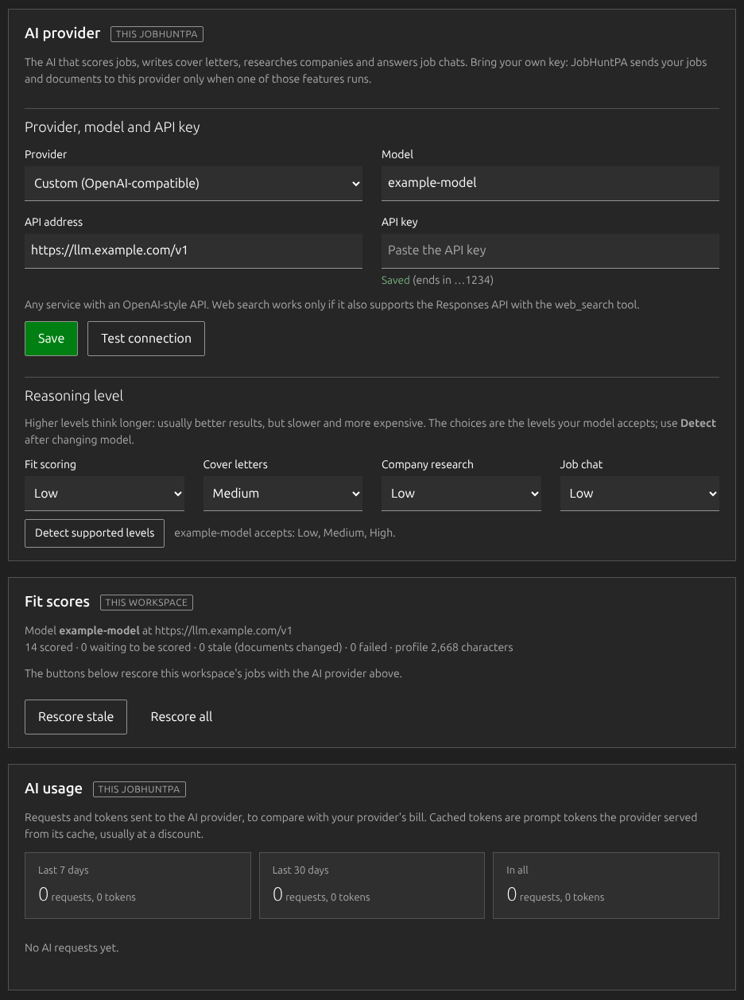

# JobHuntPA

> [!NOTE]
> JobHuntPA is a personal project, written almost entirely with AI coding assistants. It is free software under
> the [GNU GPL, version 3](#licence), and comes **with no warranty**: use it at your own risk.

A personal job search dashboard that runs on your own computer. It collects jobs from SEEK and
company careers pages, filters them against your search settings and map pins, scores the rest
against your CV with an AI model of your choice, drafts cover letters, suggests job titles to
search for, researches each employer, merges the same job advertised on several sites into one,
flags ads that may be ghost jobs, and lets you chat with the AI about any job. Your searches and
documents are stored encrypted under a key of your own (what that does and doesn't cover is
under [How your data is protected](#how-your-data-is-protected)). It has one account, yours, with a
name and a password.

There is no JobHuntPA service: you run it yourself on Windows, macOS or Linux (or on a small server at home, for
your phone too), and you **bring your own AI key** from the provider you choose. A companion
[browser extension](#browser-extension) for Chrome and Firefox adds the job you are looking at. It searches
Australian job sites (SEEK, APSJobs) and any company's careers page.


*All screenshots show a made-up job hunt in a demo workspace: the person, companies and ads are fictional.*

## A quick look

**A job's full page** (*Open ↗* on any job): the office with links to Google Maps directions from
your starting points, how well the job fits your CV and where the gaps are, what company research
found about the employer, and the whole ad.


**Map**: the jobs your filters show on an OpenStreetMap map, your pins with their radii, and the jobs in view
listed underneath.

**Chat about a job**: ask how well you fit, what to prepare for an interview, or compare jobs.


**Cover letter drafts** from your own documents, to edit, copy or download as a Word file.


**Settings**: the theme, scheduled searches (by themselves at set times on workdays, skipping public
holidays), the AI provider with the Rescore buttons and the AI usage, and the public
address ([settings for this JobHuntPA](#settings-for-this-jobhuntpa)), and [your account](#your-account)
(name, password, recovery codes, background access, download your data, import from an export).


**Themes**: Dark (above), Light, the Catppuccin, Rosé Pine, Nord, Kanagawa and Everforest
families, a dyslexia-friendly theme and themes for colour vision deficiencies, picked from live
previews on the Settings tab.


<details>
<summary>More: search setup and the per-source run report</summary>


</details>

## What you need

- A computer running Windows 10/11, macOS or Linux, and an internet connection.
- An **API key for an AI model (LLM)** from one of the major providers: [OpenAI](https://platform.openai.com/),
  [Anthropic (Claude)](https://platform.claude.com/), [Google Gemini](https://aistudio.google.com/),
  [Meta](https://dev.meta.ai/) (Muse Spark), Mistral, Groq, xAI (Grok), DeepSeek or OpenRouter, or
  any other service with an OpenAI-compatible API. A model running on your own computer with
  [Ollama](https://ollama.com/) needs no key. The first start asks for the provider, model and key in the
  browser (or skip it and add them later); you can change them any time on the Settings tab (AI provider).
  Using the model costs money on your provider account. The app still collects and filters jobs without one, but
  scoring, cover letters, title suggestions, chat and company research need it.
- Company research, finding offices and *Search the web* in chats use the provider's web search,
  which OpenAI, Claude, Gemini, Meta, xAI and OpenRouter offer. With the others everything else
  works, and the app says when a feature needs web search.

Setup takes about 5-10 minutes and needs no technical knowledge. JobHuntPA runs on your computer and
keeps your jobs, documents and API key there; there is no JobHuntPA service. What leaves it is the
requests the app makes to your chosen AI provider, to the job sites it searches, and to the map service
that places addresses and draws the map. Commute directions are links to Google Maps that you open yourself.
JobHuntPA sends no email and takes no payments. [How your data is protected](#how-your-data-is-protected)
says what is encrypted and what isn't.

## Install on Windows

1. Go to the [latest release](https://github.com/florian3706/JobHuntPA/releases/latest) and
   download **JobHuntPA-Setup.exe**.
2. Double-click it. Windows may say *"Windows protected your PC"* because the program isn't
   signed: click **More info**, then **Run anyway**.
3. Setup asks only for the install folder (press Enter to accept it). It installs Python for you if
   needed (no admin rights required) and the packages JobHuntPA uses.
4. At the end it offers to start JobHuntPA (press Enter); later, start it from the **JobHuntPA** shortcut
   on your Desktop or in the Start menu. A window opens with the app's messages and your browser opens JobHuntPA. Keep that
   window open while you use JobHuntPA; close it to stop the app.
5. The first time, the browser asks [where to keep your data](#where-your-data-lives) (the suggestion is the
   `data` folder in the install folder), then has you [create your account](#your-account) (a name and a
   password) and choose your AI provider. Setup also adds **Reset JobHuntPA** to the Start menu, for
   [starting over](#starting-over-the-reset-tool) if the password and every recovery code are lost.

## Install on macOS

*These steps are for current macOS (15 Sequoia and later); they are still **to be checked on a real Mac**.*

1. On this page click the green **Code** button, then **Download ZIP**. Safari unzips it into Downloads; move
   the folder somewhere it can stay (for example your Documents folder).
2. In that folder, double-click **`Setup.command`**. macOS refuses the first time, because the file was
   downloaded and isn't from an identified developer: click **Done** (not *Move to Bin*), open **System Settings >
   Privacy & Security**, scroll down to *"Setup.command" was blocked*, click **Open Anyway** and confirm with
   your password or Touch ID. (On older macOS, right-click the file and choose **Open** instead.)
3. A Terminal window shows setup's progress; it asks nothing about JobHuntPA. If Python 3.10 or newer is
   missing, setup offers to install it with Homebrew or opens the python.org download page: install it
   (the *macOS 64-bit universal2 installer*) and run `Setup.command` again.
4. Start JobHuntPA by double-clicking **`Start JobHuntPA.command`** (the first time, allow it under
   Privacy & Security as in step 2). Keep the Terminal window open while you use it; close it (or press
   Control-C) to stop the app.
5. The first time, the browser asks [where to keep your data](#where-your-data-lives) (the suggestion is the
   `data` folder next to the scripts), then has you [create your account](#your-account) and choose your AI
   provider.

If macOS keeps blocking the scripts, open Terminal, type `cd ` (with a space), drag the folder into the window
and press Enter, then run `xattr -dr com.apple.quarantine .` once (it removes the "downloaded" mark from the
folder's files), `./setup.sh` once, and `./start.sh` to start.

## Install on Linux

**The AppImage** (no setup, Python is inside):

1. Download **JobHuntPA-*version*-x86_64.AppImage** from the
   [latest release](https://github.com/florian3706/JobHuntPA/releases/latest).
2. Make it executable: right-click it > *Properties* > *Allow executing file as program*, or
   `chmod +x JobHuntPA-*-x86_64.AppImage`.
3. Double-click it, or run it in a terminal: your browser opens JobHuntPA. The first time it asks
   [where to keep your data](#where-your-data-lives) (the suggestion is `~/.local/share/JobHuntPA`), then has
   you [create your account](#your-account) and choose your AI provider.
4. To stop it, close its terminal, or run `./JobHuntPA-*-x86_64.AppImage --stop` (started by double-click, it
   has no window). `--help` lists the rest: `--service install` (start at boot, see
   [Hosting on your own network](#hosting-on-your-own-network)), `--reset` (the
   [reset tool](#starting-over-the-reset-tool)) and `--uninstall`.

If it says it needs FUSE, install your system's FUSE 2 library (Ubuntu 24.04 and later: `sudo apt install
libfuse2t64`; Ubuntu 22.04 and Debian: `libfuse2`), or run it with `--appimage-extract-and-run`.

**From the source:**

1. Download the ZIP (green **Code** button, then **Download ZIP**) and unzip it, or
   `git clone https://github.com/florian3706/JobHuntPA.git`.
2. Open a terminal in the folder and run `./setup.sh`. It asks nothing about JobHuntPA; if Python 3.10+
   or its `venv` module is missing, it shows the command to install it and offers to run it.
3. Start JobHuntPA from your applications menu (setup adds it) or with `./start.sh`.
4. The first time, the browser asks [where to keep your data](#where-your-data-lives), then has you
   [create your account](#your-account) and choose your AI provider.

## Where your data lives

Everything JobHuntPA keeps (the database with your jobs and documents, uploaded files, the server's key file
`server-keys.json`, the settings file `.env` with your AI key, and the browser it may download for some careers
pages) is in one **data folder**. The first start asks where it should be, with a suggestion filled in:

- **Linux:** `~/.local/share/JobHuntPA` (or `$XDG_DATA_HOME/JobHuntPA`);
- **Windows:** the `data` folder in the install folder;
- **macOS:** the `data` folder next to the scripts.

Any folder of your own works, as long as it is new or empty (JobHuntPA's files are never mixed with yours, so
the uninstaller can remove the folder). The page checks that JobHuntPA can create it and write to it. A folder
that **already holds JobHuntPA's data** (a copy of an older install's data folder, or a backup you unzipped) is
used as it is, and you sign in with its account. Nothing is written anywhere before you choose.

JobHuntPA remembers the choice in a small file, `data-folder.json`, in your configuration folder
(`~/.config/JobHuntPA` on Linux, `%APPDATA%\JobHuntPA` on Windows, `~/Library/Application Support/JobHuntPA` on
macOS). If that folder is gone the next time (an unplugged drive), the first start asks again with the old path
filled in, rather than starting an empty JobHuntPA somewhere else.

- **An existing install isn't asked and nothing moves:** a `data` folder next to the app that already holds
  JobHuntPA's data is used where it is, and an older `.env` next to the app keeps being read and written there.
  If that `.env` has a `JOBHUNT_DATA_DIR=` line naming a folder that holds JobHuntPA's data, that folder is used
  too, as before.
- **The service** ([`service.sh`](#hosting-on-your-own-network)) and other headless setups say where the data is
  with `JOBHUNT_DATA_DIR`; they are never asked.
- **To move the data later,** stop JobHuntPA, move the folder, and either edit `data-folder.json` or delete it
  (the next start asks again: choose the moved folder, which already holds your data).

## Your account

JobHuntPA has one account: yours. It signs in with a name and a password, and once it exists nobody
can make another, so someone who can reach your copy can't sign up and spend your AI key. Your account's
cards are on the **Settings** tab, below the theme, schedule and AI cards: your name, password,
recovery codes and signed-in devices, background access, then download your data and import from an export.


- **The first start** opens a page that creates the account: a name to sign in with (any name; it is
  not an email address, and JobHuntPA never sends mail) and a password of at least 10 characters (a few
  random words work well; your password manager can fill it in). It comes right after choosing
  [where your data lives](#where-your-data-lives). Everything already in JobHuntPA (workspaces, jobs,
  documents, searches and settings) moves into it. The page's address carries a one-time setup code; if
  the browser didn't open, the address is printed in the JobHuntPA window, and once the data folder is
  chosen the code is also in `first-run.txt` in it. Once the account exists the code stops working and the
  file is deleted.
- **Recovery codes:** the first-run page then shows 8 recovery codes. Copy, download or print them
  and keep them somewhere safe: if you forget your password, they are how you get back in and keep
  your data. A reminder stays at the top of the dashboard until you confirm you've saved them; to see
  them again before that, JobHuntPA asks for your password. **Keep them safe: a recovery code is the only way
  back in if you forget your password.** The page also says that **Download your data** (Settings) is your
  safety net: a copy of everything, kept wherever you like.
- **The setup walkthrough:** once your recovery codes are saved, a new account opens a short
  walkthrough (`welcome.html`) instead of the dashboard. It starts with **your AI provider**: the
  provider, the model and your API key (**Skip for now** is fine: searching, filtering and the map work
  without one, and the step says what waits for it: fit scores, cover letters, title suggestions, company
  research, questions about a job and document summaries). Then **choosing a theme**, which
  changes the page as you pick it, then setting up your search a step at a time: job titles; places,
  remote/hybrid/onsite work, days in the office and your home suburb; a salary floor and words or
  industries to include or avoid; automatic searches (background access); and an
  optional résumé (on the Documents tab, where it powers the fit scores). Every step has Back, Next
  and Skip for now, saves as you go, and picks up where you left off if you close the page. "Skip the
  walkthrough" at the bottom goes straight to the dashboard; everything is on the Search setup tab
  later. On an existing install the account gets a short version: the AI provider, a theme, then keep the
  search settings that moved into the account or review them step by step. Your theme is saved with
  your account (encrypted with your key), so a new browser or device shows it too.
- **No roles:** whoever is signed in may change every setting, the ones for the whole of this JobHuntPA
  included (see [Settings for this JobHuntPA](#settings-for-this-jobhuntpa)).

### Signing in


- **Staying signed in:** you are signed out after 24 hours of not using JobHuntPA, and after 7 days
  whatever you do. Tick *Keep me signed in* on your own device to stay signed in for up to 30 days of not
  using it (90 days at most). Don't tick it on a shared computer. **Account > Sign out** at the top right
  signs this browser out.
- **Wrong passwords:** after 5 wrong passwords in a row **from one place** (one network address, or one
  browser you have signed in with before), the next try from that place waits 30 seconds, then longer
  each time, up to 15 minutes. The wait is for that place only: someone who knows your name and
  keeps guessing locks out their own address, never you. If wrong tries come from very many addresses at
  once (100 an hour), a browser you have never signed in with is asked to wait a while; the browsers you
  usually use are not. One network address can also make only 10 sign-in requests in 5 minutes. A small cookie (`jh_device`)
  remembers a browser you have signed in with; it proves nothing about your password and opens nothing.
  The counts are kept in memory, so restarting JobHuntPA clears them.
- **Forgot your password?** On the sign-in page, *Trouble signing in?* then *I have a recovery code*:
  enter your name, a recovery code and a new password. **Your data is kept**, because the recovery
  code unlocks it; every other browser is signed out and the code is used up. This is the only way to set a
  new password without the old one: JobHuntPA sends no email, so there is no reset link. **Without your
  password or a recovery code, nobody can open your data**: it is encrypted with them.
- **No password and no recovery code?** The [reset tool](#starting-over-the-reset-tool), run on the
  computer JobHuntPA is installed on, deletes the account and its encrypted data and starts JobHuntPA over
  at the first-run page, keeping your settings. Nothing reachable from the web can do this.
- **There is no two-step sign-in:** your name and password are the whole sign-in. (An account that had
  two-step sign-in on in an older version signs in with its password after the update; the authenticator app's
  entry can be deleted.)

### Your details and devices

- **Your name** (Settings > Your name): the name you sign in with. Capitals and spaces around it don't
  matter when you sign in. Changing it asks for your password if you haven't entered it in the last 15
  minutes; you then sign in with the new name, and your password, data and sessions stay as they are. On an
  install from an older version, the email address the account was made with is its name until you change it.
- **Password, recovery codes and devices** (Settings > Password, Recovery codes and Signed-in devices): change
  your password (your data stays readable, and other browsers are signed out unless you untick that), make 8
  new recovery codes (the old ones stop working; you enter your password, and save the new ones the same way as
  the first set), and *Sign out everywhere else* (which also
  disconnects your [browser extensions](#browser-extension)). Anything
  sensitive asks you to confirm your password first, if you haven't entered it in the last 15 minutes. If you
  think someone had your session, change your password, make new recovery codes and sign out everywhere else.
- **Starting over:** the account can't be deleted from the app, because that would put JobHuntPA back at its
  first run, which only the [reset tool](#starting-over-the-reset-tool) on the computer itself may do.
  Download your data first if you want to keep anything.
- **An install from an older version with several accounts** keeps them all: each signs in with its own
  name and password and keeps its own workspaces (nobody else can open them), and none can be added. Each of
  them except the last can delete itself (Settings > Delete account, with its password): its workspaces,
  jobs, documents and uploaded files, chats, cover letters, keys and sessions go, and the job ads and
  company research everyone shares stay. It can't be undone, and it waits while one of its searches runs.
  Every account may change this JobHuntPA's settings.
- **Headless servers and CI:** instead of the first-run page, start JobHuntPA with
  `JOBHUNT_ADMIN_EMAIL` (the account's name, despite the variable's older name) and `JOBHUNT_ADMIN_PASSWORD`
  in its environment (exported, or in the service definition; never in `.env`, which is ignored for these
  two) and the account is created at start-up. Once an account exists they are ignored. Its recovery codes
  are shown after its first sign-in.

### Download your data

**Settings > Download your data** makes a zip file with everything JobHuntPA keeps for your account, as
files in folders made for people. Tick the file types you want, any of **Markdown** (`.md`), **Word**
(`.docx`) and **OpenDocument** (`.odt`; at least one): each text file comes once in every type you tick. It is
your safety net: keep a recent copy somewhere safe.

- `Account.md` (with the job sites whose layout the AI worked out);
- for each workspace: its search setup, sources (and whether each has a worked-out layout), documents (with the original files you uploaded, byte
  for byte), jobs sorted into folders by your status (each with its fit score, description, cover
  letter, the signs of a possible ghost job and the other sites that advertised it), jobs the filters
  left out, your chats and search history;
- the company research behind your jobs;
- `JobHuntPA import file.json`: the same data in one file for a computer, which **Import from an export**
  (below) reads. Its format is in `docs/design/open-source.md`, Part 7.

Links between the files work offline. It asks for your password again if you haven't entered it in the
last 15 minutes. The zip is made in memory, so nothing is written to disk on the server. An export is
refused above 200 MB of files, and the server makes only a couple at a time: try again in a minute. An
export keeps its place until your download has ended, so a slow or abandoned download holds it for up to
10 minutes, plus the time the zip needs at 100 KB/s. **The zip is not encrypted**: keep it somewhere
safe. It holds only your own data, and never your password, recovery codes, keys, sign-in sessions,
browser extension keys or the AI key.

### Import from an export

**Settings > Import from an export** brings workspaces back from a zip that Download your data made, on the
same JobHuntPA or another one (a new computer, say). Choose the zip and press **Look inside**: the card lists
the workspaces in it with their jobs, documents and chats. Tick the ones you want and press **Import the
ticked workspaces**.

- Each one becomes a **new workspace**: nothing is merged into the workspaces you have. If you already have one
  with that name, the new one is called "My job search (imported 2026-10-13)" (with that day's date), then
  "(imported 2026-10-13, 2)" and so on.
- It brings the search setup, places, sources (with their worked-out layouts; never one on your local network),
  search schedule, documents (with the files you uploaded), jobs (with your status, what you hid, the filters'
  reasons, offices, fit scores and cover letters) and chats, and the job sites' layouts for the sites you have
  none for.
  A job this JobHuntPA already has from another search is linked to it; any other job is kept as your own.
- The company research in the file is only used where this JobHuntPA has none, or older.
- It asks for your password again if you haven't entered it in the last 15 minutes. The zip is read in memory
  and never unpacked on the server; only the import file and the uploaded files it names are read from it.
- Exports made before JobHuntPA 2.0.0 have no import file and can't be imported (the card says so); an export
  from a newer JobHuntPA than this one is refused too: update JobHuntPA first.

### How your data is protected

Your searches, documents and jobs are **encrypted with a key that only your password or a recovery
code can unlock**. Someone who copies the database, its backups or the `data/` folder can't read
them by looking, not even the person who runs this JobHuntPA, unless you allow background access
(below). That is the whole promise: it protects data at rest. It does not stop someone who changes the
running app or reads its memory (see *The limits*), and it is not a promise about anything outside
JobHuntPA, such as your AI provider.

> **Save your recovery codes.** If you forget your password, a recovery code is the only way to get
> your data back. Without one, your encrypted data can't be opened again by anyone.

**Encrypted** (under your key):
- your sign-in name (JobHuntPA finds your account by a keyed hash of it, so the name itself isn't stored in
  the clear);
- each workspace's name, search setup (titles, keywords, salary, places, the commute's starting
  points), dealbreakers and map pins (their places and radii);
- your jobs: their status, whether you hid them, why the filters excluded them, distance and
  place, the office you set or that was found, your call on the location, and anything that is only
  yours, such as a full ad you uploaded or a job imported from a saved page (its address too);
- fit scores and their evidence, cover letters, chats, and what each search run found;
- your documents and notes (title, text and concise version), and **uploaded files**: they are
  stored encrypted (`data/uploads/*.sealed`), and their text is read in memory, never written out;
- company careers pages you added and your theme.

Even whether a job is hidden or excluded doesn't show: those fields are always stored encrypted,
and an excluded job looks the same as one you kept.

**Not encrypted**, because the app needs them without your key or they aren't yours. Someone with the
database can see:
- **job ads themselves**: ads are public, so they're stored once and shared by every search. Which
  ads your workspace has is visible (not what you think of them), and that shows roughly what you search
  for and when each ad was first linked to you. A job imported from a saved page is the exception: it is
  sealed, address included;
- company research (public, shared by every search), which companies were researched, which
  places were looked up, and AI usage counts for each purpose;
- how many workspaces, jobs and documents you have, how long each text is (the stored length is the
  text's length plus 33 bytes), the size of each uploaded file, and every date and time: when jobs were
  seen or closed, when searches, chats and sign-ins happened (your last active day is stored by day only);
- the kind of each document and pin, which documents are used for scoring, the kind and state of each
  search run, and the AI model names;
- when each workspace's scheduled searches run, including its state, and which ads you merged or split;
- your account's sign-in state: whether it is turned on and whether background access is on.

**Logs.** The messages JobHuntPA prints in its window name the kind of failure and an account number,
and never your name, job text, documents, chats or any password, token or key.
`tests/test_log_leaks.py` runs a whole account through the app with everything planted in it and checks
this at the most detailed logging level. Two things are outside that check: the one-time setup code is
printed on purpose, and the traceback of an unhandled error (a bug) could name data.

**The limits.**
- **Your AI provider** sees what it scores, chats about or writes (your documents, the jobs, your chats)
  under the provider's own retention rules. The cache keys sent to providers are hashes of your documents.
- **The running app** holds your data in memory while you use it, and memory can end up in swap files or
  crash dumps. Someone who changes the app's code on the server, sees the traffic before HTTPS is applied,
  or reads its memory could capture your password when you next sign in. Nothing stored on disk can
  prevent that.
- **With [background access](#background-access) on,** whoever runs the server can read your data, using
  the key file (see *Background access*).
- **Wrong passwords** are counted per place in memory (see *Signing in*), so a restart gives each place its
  five tries back. A guesser with many addresses gets 5 tries per address up to 100 an hour for the whole
  account; IPv6 addresses count one by one, so a whole /64 can rotate through that
  ceiling.
- **Old copies of a key** (a spent recovery code, or background access you turned off) can stay in the database's log file
  for a short while until it is cleaned up; JobHuntPA checks every 10 minutes. On SSDs and SD cards, deleted
  data may linger in storage the disk manages itself.
- **Other accounts on the same computer** can't read the `data/` folder, the database or its backups:
  JobHuntPA makes them readable by you only (on Windows it relies on the folder's permissions). The
  computer's administrator (root) and you can still read everything.

**If someone can change the database file, not only copy it,** a few things in it are not protected by
your key: the lookup values the app needs before anyone signs in (which account a name belongs to, which
account is turned off). Someone who has the database **and** the key file `server-keys.json` can do anything the
server can with the data of an account that has background access.

### Background access

Settings > **Background access** is a switch for your account.

- **Off** (the default for a new account): only you can unlock your data. JobHuntPA can't run
  searches while you're away, so **scheduled searches are skipped** (the schedule card says so).
- **On** (ticked by default on the first-run page): JobHuntPA keeps a key on the server so it can run scheduled
  searches while you're away. The server's operator could technically read your data.

How it works: turning it on (it asks for your password again if you haven't typed it in the last 15
minutes) stores a copy of your data key locked with the server's own key, in `server-keys.json` in the data folder.
Whoever has the database **and** that file can read the data of an account with it on. Turning it
off deletes that copy at once. The setup walkthrough's *Automatic searches* step turns it on for you
if you tick it. Back up `server-keys.json` with the database; it also records that the one-time
encryption of an older install has finished, so restore the two together.

Your recovery codes are never under the server's key: background access opens your data, not the codes
you haven't yet confirmed saving.

- **Delete the old `.bak-*` files** (`data/*.bak-before-encryption`, `*.bak-before-job-pool`, the
  uninstaller's zips once you have no use for them; the Settings tab's **Unencrypted copies of data** card
  lists and deletes the first two). They keep the keys from before the update, so someone who has one
  together with the key file can still read what they held.
- **Recovery codes saved in an older version** still reset your password and keep your data.

## Settings for this JobHuntPA

The Settings tab's cards marked **This JobHuntPA** apply to every workspace (and, on an older install with
several accounts, to every account). Whoever is signed in may change them; nothing on them resets or deletes
your data.

- **AI provider:** the provider, model and API key, the reasoning level for each task and **Test connection**
  (see [Changing your AI provider or key](#changing-your-ai-provider-or-key)).
- **AI usage:** the requests and tokens sent to your provider, in all, in the last 7 and 30 days and by task
  (scoring, research, cover letters, chat ...), with how much the provider served from its cache: handy to
  compare with your provider's bill.
- **Public address and host names:** for using JobHuntPA from your phone or other computers (below, and
  [Hosting on your own network](#hosting-on-your-own-network)). Saving them asks for your password if you entered
  it more than 15 minutes ago, because they widen which addresses JobHuntPA accepts.
- **Browser for JavaScript pages:** a few careers pages show their jobs only with JavaScript. JobHuntPA reads
  them with a browser component (Chromium, about 180 MB), which it downloads into your data folder only when
  you click **Download the browser** here, or **Download it** when the Search setup tab offers it after a careers
  page needed it. Until then (and if you choose **Not now**) those pages say in their test result what they need.
- **Server key** and **Unencrypted copies of data** (below).



Changes take effect at once and are saved in `.env` in the [data folder](#where-your-data-lives) (an older
install's `.env` next to the app keeps being used); the log names the settings that changed, never their values. Keys are never shown again in full, only their last few characters.

### Reaching JobHuntPA from other devices and addresses

JobHuntPA only answers requests for an address it knows, so a web page on another site can't make your
browser talk to it under a name of its own (a "DNS rebinding" attack). It answers these:

- **any IP address**: `http://127.0.0.1:8000`, a home-network address such as `http://192.168.1.20:8000`,
  or a Tailscale address (`100.x.y.z`);
- **`localhost`** and names ending in `.localhost`;
- **this computer's own names**: its host name, with or without `.local` (`http://homeserver:8000`);
- **the public address** (Settings > Public address and host names > *Public address*; `PUBLIC_BASE_URL` in `.env`);
- **any other names you list** there under *More host names* (`JOBHUNT_ALLOWED_HOSTS` in `.env`, separated by
  commas: `jobs.example.com,homeserver.tail1234.ts.net`). Use names only (no `http://`, port or path).

The port never matters. Anything else gets "This address isn't allowed" (HTTP 400) and nothing else runs.
**With `tailscale serve`** (or any proxy that passes the name people typed on), set the public address to
the address it gives you: in **Settings > Public address and host names**, type `https://homeserver.tail1234.ts.net`
(no `/` at the end; `http` is accepted only for `localhost`) and click **Save**. That is enough, and it also
makes the sign-in cookie secure; it takes effect at once (this browser may be signed out, because the cookie's
name changes with https). Without a public address, list the name under *More host names* instead. You can
also put `PUBLIC_BASE_URL=https://homeserver.tail1234.ts.net` or `JOBHUNT_ALLOWED_HOSTS=...` in `.env` and restart
JobHuntPA. Start JobHuntPA through `start.sh` or the launcher, which already trust the proxy on the same
computer (`--proxy-headers --forwarded-allow-ips 127.0.0.1`). The proxy must **append** the real visitor's
address to `X-Forwarded-For` (`tailscale serve` and the usual proxies do); one that passed a visitor's own
header through unchanged would let anyone choose the address JobHuntPA counts their sign-in tries under.

**Give JobHuntPA a host name of its own.** The sign-in cookie is kept per host name, and browsers ignore the port,
so JobHuntPA puts the port into the cookie's name (`jh_session_8001`): a test copy on port 8001 and the live app
on 8040 on one computer don't sign each other out. Other apps on
the same host name still receive the cookie, though, so use a name only JobHuntPA answers to (such as
`jobs.example.com` or its own Tailscale name) rather than sharing `localhost` or a host name with other
web apps.

### The server key and unencrypted copies

**The server key** (`server-keys.json` in the data folder) protects the keys kept for background searches. *Replace the
server key* (Settings > Server key, with your password) moves them all to a new one and drops the old one; if
something can't be moved, the old key is kept and nothing is lost. Do it if the `data` folder or a backup of it
may have been copied by someone else. You can also run `python -m backend.keys rotate-kek` with JobHuntPA
stopped. The app holds a lock on its key file for as long as it runs, however it was started, and these
commands refuse while they can't get it (if the launcher's `running.json` in the data folder is left over from a
crash, delete it). A running JobHuntPA also won't overwrite a key file that something else changed: it stops with
"The key file was changed by something else", and a restart picks up the new file.

**Unencrypted copies of data** appears after an older install's data has been encrypted: it lists the files
that still hold it unencrypted (the backup made before encrypting, older `data/jobhunt.db.bak-*` backups and the
`data/cache` pages of an earlier version) with **Delete these files now**, which asks for your password.

### Starting over: the reset tool

For when the password and every recovery code are lost, or you want a clean start. It runs on the computer
JobHuntPA is installed on, never from the web:

- **Linux and macOS:** stop JobHuntPA, then run `./reset.sh` in the app folder (on a Mac you can double-click
  **`Reset JobHuntPA.command`**; right-click > Open the first time).
- **Windows:** stop JobHuntPA, then choose **Reset JobHuntPA** in the Start menu.
- **The AppImage:** stop JobHuntPA, then run `./JobHuntPA-*-x86_64.AppImage --reset`.

It says what will be lost and asks you to type **RESET**, exactly, in capitals; anything else stops it with
nothing changed. It
refuses while JobHuntPA is running. Then it deletes the account (every account, on an older install with
several), its encrypted data (workspaces, jobs, documents and uploaded files, chats, search setup, schedules,
the page layouts the AI worked out),
its keys, recovery codes and sessions, and the server key file. **It keeps** your settings (`.env`: the AI
provider, model and key, and the public address), the reasoning levels, the shared job ads,
the company research, the AI usage counts (no longer tied to anyone), the downloaded browser and the data
folder itself. The next start is a first run in the same data folder, where you create a new account. Nothing can bring the deleted data back: if you can still sign in, **Download your
data** first. For scripts, `./reset.sh --confirm RESET` answers the question (`JobHuntPA-Reset.exe --confirm
RESET` on Windows).

## Hosting on your own network

JobHuntPA listens on its own computer only (`127.0.0.1`). To use it from your phone or other computers, keep
it running on one computer (a Raspberry Pi, a home server, an always-on PC) and put a proxy on that same
computer that gives it an HTTPS address: **Tailscale's `serve`** (simplest, and private to your own devices) or
**any reverse proxy** (Caddy, nginx). Both routes follow the same three steps.

### 1. Start JobHuntPA at boot (Linux)

`service.sh` makes a systemd user service that starts JobHuntPA when the computer starts, without a browser
or a window:

```
./service.sh install --port 8000 --data-dir ~/.local/share/JobHuntPA
./service.sh status          # installed, running, answering?
./service.sh remove          # stop it and remove the service (the data stays)
```

With the AppImage, the same is `./JobHuntPA-*-x86_64.AppImage --service install --port 8000` (keep the AppImage
where it is: the service runs it from there).

- `--port` is the port on this computer (default 8000); `--data-dir` is the
  [data folder](#where-your-data-lives) (default: the one JobHuntPA already uses, else
  `~/.local/share/JobHuntPA`). Like the first run's folder question, it takes a new or empty folder or one that
  already holds JobHuntPA's data, never a folder of your own files. Run `install` again to change them.
- The service passes the folder to JobHuntPA (`JOBHUNT_DATA_DIR`), so its first run skips the folder question.
  `remove` says where the data is and, when nothing else names a data folder, remembers that one
  (`data-folder.json`), so starting JobHuntPA by hand afterwards keeps using it.
  If there is no account yet, open `http://127.0.0.1:8000/first-run.html` on that computer and paste the
  setup code from `first-run.txt` in the data folder (or `journalctl --user -u jobhuntpa | grep first-run`).
- To start before anyone signs in to the computer, the service needs "lingering"; `install` turns it on, and
  says so if it couldn't (then run `sudo loginctl enable-linger $USER` once).
- Messages: `journalctl --user -u jobhuntpa -f`. Stop it for a while with `systemctl --user stop jobhuntpa`.
- Don't also start JobHuntPA with `start.sh` on the same data folder while the service runs: the second copy
  refuses to start, because the key file is in use.

On Windows or macOS, keep JobHuntPA running with its shortcut or `start.sh` instead.

### 2a. Tailscale serve (private to your devices)

1. Install [Tailscale](https://tailscale.com/download) on the JobHuntPA computer and on each phone or computer
   that should reach it, and sign in to the same account on all of them.
2. In the Tailscale admin console, open **DNS**: keep **MagicDNS** on and, under **HTTPS Certificates**, click
   **Enable HTTPS**.
3. On the JobHuntPA computer, run `sudo tailscale serve --bg 8000` (the port JobHuntPA uses). It prints the
   address, such as `https://homeserver.tail1234.ts.net`; `tailscale serve status` shows it again.
4. In JobHuntPA (on that computer, or at that address), open **Settings > Public address and host names**,
   type the address under **Public address** (no `/` at the end) and click **Save**.
5. Open the address on your phone and sign in. Only devices signed in to your Tailscale account can reach it.
   Don't use `tailscale funnel`: that puts JobHuntPA on the public internet.

To stop sharing it: `sudo tailscale serve --https=443 off`.

### 2b. A reverse proxy (Caddy, nginx)

Run the proxy on the JobHuntPA computer and point a name at that computer (in your router's DNS, a
`hosts` file, or a public DNS record). The proxy must pass on the name people typed (`Host`) and **append**
the visitor's address to `X-Forwarded-For`; uploads and imports need large bodies (up to 250 MB).

With [Caddy](https://caddyserver.com/), which gets and renews the certificate itself (for a public name; for a
name only your network knows, add `tls internal` and trust Caddy's certificate on your devices), the whole
`Caddyfile` is:

```
jobs.example.com {
    reverse_proxy 127.0.0.1:8000
    request_body {
        max_size 250MB
    }
}
```

With nginx, a server block like this (the certificate from Let's Encrypt or your own):

```
server {
    listen 443 ssl;
    server_name jobs.example.com;
    ssl_certificate     /etc/ssl/jobs.example.com/fullchain.pem;
    ssl_certificate_key /etc/ssl/jobs.example.com/privkey.pem;
    client_max_body_size 250m;
    location / {
        proxy_pass http://127.0.0.1:8000;
        proxy_set_header Host $host;
        proxy_set_header X-Forwarded-For $proxy_add_x_forwarded_for;
        proxy_set_header X-Forwarded-Proto $scheme;
        proxy_read_timeout 300s;
    }
}
```

Then set **Settings > Public address and host names > Public address** to `https://jobs.example.com` and click
**Save**.

### 3. Check it

- Open the public address on another device and sign in; the browser shows the padlock.
- "This address isn't allowed" means the name isn't known to JobHuntPA: set it as the public address, or add it
  under *More host names* ([Reaching JobHuntPA from other devices and addresses](#reaching-jobhuntpa-from-other-devices-and-addresses)
  has the rules).
- Keep the proxy on the same computer: JobHuntPA trusts proxy headers only from `127.0.0.1` (`start.sh`, the
  launcher, the AppImage and the service all start it that way). Don't open port 8000 itself to the network.
- The [browser extension](#browser-extension) connects to the public address as well.

## Using it

The dashboard opens at http://127.0.0.1:8000 (sign in first). Start in **Search setup** (job titles, keywords,
salary, work modes and [company careers pages](#adding-company-careers-pages)), upload your CV under **Documents**, drop pins for
where you can commute on the **Map**, then click **Run search** on the Jobs tab. Separate searches
can live in their own **workspaces** (switcher at the top right).

Every feature, the AI ones included, works once you sign in: there are no memberships, payments or
limits on searches. The AI features use the provider and key set on the Settings tab (AI provider).

- **AI tasks** (the button at the top of every page, with a number): how many AI tasks are
  running for your account right now: search runs and their scoring, scoring, company research,
  office look-ups, cover letters, chat answers, document summaries and shorter versions, title
  suggestions. Click it to see the list: what each task is, for which job, company or document,
  since when, and how far it is where that is known (*3 of 10 done*). The list comes from
  JobHuntPA itself, so it is still there after a reload or in another tab, and a screen reader
  says when the number changes. Tasks can't be cancelled: each one ends by itself.
- **Scheduled searches** (Settings > Scheduled searches): tick *Run searches automatically* and the
  search runs by itself at 10:00, 12:00, 14:00 and 16:00 Monday to Friday, skipping public
  holidays, including substitute days (a holiday that falls on a weekend moves to the Monday). They
  are off in a new workspace (a workspace from an earlier version keeps its setting). Change the
  times and days, or switch it on or off, per workspace. Pick your state: it sets which public holidays apply and the time zone of the
  times. Searches only run while JobHuntPA is running; a search missed because it was closed runs
  if you start it within the hour. Each run scores the new jobs it finds, like **Run search**.
  **Scheduled searches need [background access](#background-access)** (Settings > Background
  access): your jobs are encrypted, so while you're signed out the server can only search for you if
  it holds a key. Without it each slot is skipped, and the schedule card says "Scheduled search
  skipped: background access is off".

  

- **Tracking and tidying**: set each job's status (to review, shortlisted, applied, interviewing,
  rejected, not interested). Moving a job to *Applied* keeps the date: the card and the job page
  show *Applied* and the date while it stays there (moved away and back, the latest move; a job
  that was already in *Applied* before this version shows no date), and the data export has it. Tick jobs, or filter the list and tick **Select all shown**, to change
  status or **Hide** them in bulk (only jobs on screen are ever affected); hidden jobs stay hidden when a search finds them again, aren't scored or
  researched, and come back with *Show hidden*.
- **Softening the office-days rule**: if you set a maximum number of office days for hybrid roles,
  the Jobs tab's **Office days (temporary)** menu lets you allow extra days (up to 5) for now. Jobs that
  only that rule excluded reappear, marked *shown by temporary +N office days*, and **Score them**
  scores any that were never scored. Nothing is saved: *Back to my rule*, reloading the page or
  switching workspace restores your saved limit.
- **Government jobs**: Australian Public Service jobs come from APSJobs. Add a source such as
  `https://www.apsjobs.gov.au/s/job-search?department=Services%20Australia` (the agency name as
  APSJobs lists it) or `...?searchString=product%20manager` for a search across all agencies.
  Careers pages that publish an RSS feed (e.g. SBS) can be added by the feed's URL.
- **Shared job pool**: every job any search finds is stored once and shared by all workspaces, so
  an ad's full page is fetched only once. Each search also brings in jobs that other searches
  already found, if they match your own job titles or include keywords and pass your filters
  (dealbreakers, salary, work mode, pins). A workspace with no titles or keywords gets none.
  Everything you do with a job stays with your workspace: status, hidden, why it's excluded, score,
  office, location call, cover letter and chats.
- **Closed jobs**: a job counts as closed when its page is gone, when its employer's complete job
  list no longer has it, or when no search has listed it for 45 days (how SEEK jobs close, since
  SEEK results are only the first page). A closed job that is listed again reopens. Jobs missing
  from one search's results aren't closed: another search may still list them.
- **Full SEEK ads**: SEEK jobs marked *summary only* have an **Upload full ad** button. Save the
  ad's page from SEEK in your browser and upload it to score the job on the whole ad. The full ad
  you upload stays private to your workspace: other workspaces with the same job keep seeing SEEK's
  summary. Jobs from pages you import (*Search setup → Import saved pages*) are private too,
  unless a search has already found them.
- **Company info** (ⓘ next to the employer, and the job page): what company research found
  (business, ownership, offices, Employee sentiment and News/Controversies) is shared by all
  workspaces, so a company is researched once. **Fill missing info** researches companies with no
  profile yet, a failed one, or one older than 30 days. You can research again whenever you like:
  **Research the whole profile again** at the bottom of a profile researches all of it, and
  **Research again** under *Employee sentiment* or *News/Controversies* researches only that
  section (each shows the date it was last researched).
- **Suggested job titles** (Documents tab): the AI reads your documents and suggests titles to
  search for; add them to the current search or start a new workspace with them.
- **Notes** (Documents tab): under *Write a note*, give a note a title, type its text, pick a
  type and click **Save note**. Use notes for things that aren't in your CV, such as a project you
  led, or what you want from your next job. A note works like an uploaded document: tick or untick
  *use for scoring*, **Open** it to edit its text, title or type, or **Delete** it. Notes are
  plain text and are stored only in JobHuntPA.
- **Preferences** (a document type for uploads and notes, next to *Resume / CV*, *Cover letter* and
  *Other/supporting*): say what you want from a job, such as the commute you'll accept or work you
  want to avoid. The AI uses
  them when scoring jobs (it names jobs that conflict with them), in job chat and in suggested job
  titles. They are never treated as experience, and they are never sent when drafting cover letters.
- **Concise versions**: **Open** a document and use *Create concise version* to have the AI write a
  shorter version of it. Read it against the original and edit it, then *Save concise version*.
  *Write it again* replaces it. Choose whether the AI gets *the original* or *the concise
  version*. Switching, or editing the version in use, marks existing scores as out of date, so
  they're recalculated with the new text. For an uploaded file, only the concise version can be edited.
- **Summary of your documents**: *Create summary of ticked documents* merges every ticked document
  (not preferences) into one new document, with each fact once and every employer, date, number and
  qualification kept. It takes a few minutes. The summary opens so you can read and edit it. Once
  you're happy, click *Untick the originals* so the same facts aren't sent twice (or *Keep both ticked*).
- **What documents cost**: your ticked documents are sent to the AI with every job it scores and
  every chat question, so long ones add up. JobHuntPA asks providers to cache them so repeats cost
  less. For Claude (directly or through OpenRouter) it marks the documents for caching; for
  OpenAI, Meta and Mistral it sends a cache key. OpenAI, Meta, xAI, Gemini, DeepSeek, Groq and OpenRouter's other
  models cache on their own, and Ollama runs on your computer. Either way the documents are still
  sent each time; caching only makes a repeat cheaper and faster. Concise versions and a summary
  cut the size, and with it the cost. When the ticked documents come to more than 50,000
  characters (counting the concise versions where the AI gets those), the Documents tab says so and
  points to *Create summary*. It is a warning only: nothing stops you sending more.
- **Cover letters**: *Draft cover letter* on any job writes a first draft from your documents
  (upload earlier cover letters as "Cover letter" documents to match your style). Edit it, then
  copy it or download it as a Word file. Always check it before sending.
- **Chat about jobs**: *Chat* on a job (or tick several and click **Chat about N jobs**) opens a
  chat on the right. The AI sees the ads, your documents, the fit assessment, the company info and
  any cover-letter draft, so you can ask what the role really involves, how to handle your gaps,
  what to ask in an interview, or which of several jobs suits you best. Tick *Search the web* for
  things your saved data doesn't cover (news, salaries); the pages it used are listed under the
  answer. Chats are saved per job set; *New chat* starts over.
- **Duplicate ads**: the same job advertised on several sites (say SEEK and the employer's own
  careers page) becomes one card, with the other sites under *Also on*. The card shows the fullest
  ad, and when one of the copies is on the employer's own site, the job's title links there (on the
  card and the job page). The app merges ads it's
  sure about after each search and lists the doubtful ones under **Duplicates** for you to decide
  (*Same job: merge* / *Different jobs*). Your status, cover letter and score carry over to the
  merged card. *split* (under *Also on*, or beside the employer's site) undoes a merge; **Merge as
  one job** (tick two or more jobs) merges ads the app missed.
- **Job page**: *Open ↗* on a job opens it in a new tab: the whole ad, the fit and gaps, the office
  (with every office company research found for the employer, to pick from), the company profile,
  and [commute links](#commute-links) to Google Maps.
- **Map**: two modes. **Jobs** shows the jobs your Jobs tab filters show, with your pins and their
  radii, and lists the jobs in view under the map (click a dot, or **Show** in the list, to see a
  place's jobs; **Open ↗** for a job's full page in a new tab); nothing can be changed by accident.
  **Edit pins** drops a pin where you click or tap (drag to move). Without a mouse, move the map
  (arrow keys) until the cross in its middle is on the place and press **Drop a pin at the cross**;
  **Move to the cross** in the pin list moves a pin there. *Only list pins in view* shortens the
  pin list to the area on screen.
- **Office locations**: most ads only say "Sydney NSW", or an area such as "North West & Hills District"
  (placed at its main centre, here Castle Hill, for the location filter). Instead of trusting that, such jobs show
  **office unknown** until the office is found: the scorer reads it from the full ad, and company
  research (**Fill missing info**) finds the employer's office addresses. An office named in the ad
  wins; otherwise, with several offices in that city, the one closest to your commute pins is used
  (you can pick another on the job page). Recruitment agencies rarely name the client, so their ads are left to you: on the job
  page set the office (address or suburb, or one of the employer's offices), or make the call with
  **Location OK** / **Too far**. The office then drives the location filter and distance.
- **Themes** (Settings > Theme, saved with your account and remembered by the browser): each theme is a card with a small live
  preview of the app in it; click or tap one, or move through them with the arrow keys, and it
  applies at once (open job pages follow). Dark (the default), Light, or *System* to follow your
  computer; Catppuccin (Latte, Frappé, Macchiato, Mocha); Rosé Pine (Rosé Pine, Moon, Dawn); Nord
  (dark, and a light variant made from Nord's colours); Kanagawa (Wave, Dragon, Lotus); Everforest
  (dark and light, medium contrast); a **Dyslexia** theme (warm low-glare background, Atkinson
  Hyperlegible font, wider letter and word spacing) in light and dark; and colour-vision themes
  (Protanomaly, Deuteranomaly, Tritanomaly, Dichromacy, Monochromacy), each in light and dark. The
  family themes use their projects' official palettes; where a colour fell short of the WCAG AA
  contrast minimums it is a little lighter or darker in the same hue (themes.css lists each change).
  Labels, marks or shapes always accompany colours, so nothing relies on colour alone. See
  [Accessibility](#accessibility).
- **Reasoning level** (Settings > AI provider): how long the AI thinks, set separately for scoring,
  cover letters, company research and job chat. *Detect supported levels* shows what your model accepts.

## Ghost jobs

Some ads stay up when nobody is being hired: a "talent pool" ad that collects applications for later, a
role posted again and again, an ad left open for months. JobHuntPA can't know, so it shows **signs** and a
rating made from them, and never hides, scores or ranks a job down because of them.


- **The circle:** under its fit score (🎯), every job card, the map list and the job page show 👻 and a
  coloured circle:
  - 🟢 no signs, or only one or two weak ones;
  - 🟡 some signs: the card adds **Possible ghost job (some signs): why?**, which lists them;
  - 🔴 one strong sign, or several moderate ones (**several signs**).

  Hover over the circle to read the signs that were found. It is a rating from the signs, not a measurement:
  the app puts no number on it.
- **Why this rating:** open the job. **Is this a real vacancy?** shows the circle and the rating in words, and
  says what it rests on: it is worked out from your own searches only, and it indicates whether an ad may be a
  ghost job or a real position; it proves neither. Open **Why this rating** under it for every kind of sign and
  whether it was found (and how strong it is), not found, or could not be checked (the company hasn't been
  researched, or the job didn't come from a search and has no listing history), what the colours mean and, for
  a flagged job, what to ask the employer.
- **The signs:**
  - the ad has been open for 45 days or more (the longer, the stronger);
  - the same role from the employer was listed before, ended and was listed again;
  - the posted date was renewed while the ad stayed listed;
  - wording such as "talent pool", "talent community" or "register your interest";
  - five or more open ads for the same role at one company;
  - a recruiter's ad that may not name the employer;
  - recent news of job cuts at the company (from company research);
  - the AI's reading of the ad, when it finds wording that says the job isn't a current vacancy (it can be
    wrong, and alone it is never "several signs").
- **Nothing is hidden for it:** a possible ghost job stays in your list like any other. The data export lists
  the signs.

## Adding company careers pages

SEEK has most jobs, but many employers also (or only) advertise on their own careers page. Add
those under **Search setup > Company sources**, once per workspace:

1. Find the company's page that **lists** its open jobs (usually behind "Careers", "Join us" or
   "Open roles"): the list, not a single ad.
2. Paste its address into **Careers page URL**, type the company's name if you like (shown on its
   jobs when the page doesn't say), and click **Add**.
3. Click **Test**. It shows what the app finds without saving anything: how many jobs, how it read
   them and a few titles. It can take a minute, because the app waits between requests to a site.
4. From now on, **Run search** and the scheduled searches collect its jobs. Untick a source to
   skip it for a while; **Delete** removes it (its jobs stay in your list).


**Many pages at once.** **Bulk add** takes a list of careers pages, pasted or from a file, and
**Export sources** saves the workspace's list in the same format, so you can pass it on or load it into
another workspace. The format is CSV (UTF-8 text) with the columns `company,url`: one page a line, a
first line `company,url` if you like, and double quotes around a name that contains a comma (write a quote
inside a name twice):

```csv
company,url
"Smith, Jones & Co",https://careers.smithjones.example/jobs
Acme,https://jobs.lever.co/acme
```

1. Click **Bulk add**, paste the list or choose the file, and click **Show the list**.
2. Check the list. **Nothing has been fetched from any of the sites yet**, not even a name look-up.
   Untick or **Remove** the pages you don't want. A page is marked **Unusual**, with the reason, when its
   address is a raw IP address, carries a user name or password, is a link shortener, has a lookalike or
   encoded name (punycode, mixed alphabets, `%` codes), uses plain `http` or names an odd port. Those start
   unticked: tick one only if you know the address is right. The marks judge the address's shape only; they
   are not a safety check of the site. An address on your local network or this computer, or one that isn't
   a web link, can't be added at all.
3. Click **Add**. Each ticked page is added the way a single one is, and each line says what happened:
   *added*, *already there* (the source you have is left as it is), *repeated in the file* (only the first
   counts) or *could not be read*.

**Which address to use.** Many companies run their jobs on a hosted job board. The app reads
those boards' own job feeds, which is quick and complete, so if a careers page links to one, the
board's address works best (the careers page itself usually works too, as the app follows the link):

| Job board | Address looks like |
| --- | --- |
| Workable | `https://apply.workable.com/company/` |
| Greenhouse | `https://job-boards.greenhouse.io/company` |
| Lever | `https://jobs.lever.co/company` |
| Ashby | `https://jobs.ashbyhq.com/company` |
| SmartRecruiters | `https://jobs.smartrecruiters.com/Company` |
| Workday | `https://company.wd3.myworkdayjobs.com/en-US/Careers` |

Any other careers page works if its jobs are on the page or one click away: the app reads the job
data many sites embed for search engines, or else follows the links to each ad (and "next page"
links), and opens pages that only appear in a real browser in a hidden one. A job feed (RSS)
can be added by its address, and for government jobs add an APSJobs search (see *Government
jobs* above). An address on your local network or on this computer, or one that isn't a web link,
can't be a source, however it is added (one at a time, in bulk, or from an export), and the app doesn't
follow a page's redirect to one. A page opened in the hidden browser is stopped from loading anything from such
an address; if something on it is redirected there, the browser has already sent that request, so the app
throws away the whole reading.

**When the app finds no jobs on a page**, the [browser extension](#browser-extension) can have the AI work
out where the page lists them: open the careers page in your browser and use the extension's **Add as a
company source**. JobHuntPA first reads the page the usual ways; if they find nothing, the extension sends it
a trimmed outline of the page (element names, a few attributes and short text samples; no scripts, styles or
form values) and the AI says, as selectors, where each job, its title and its link are. JobHuntPA then reads
the page **itself** with that layout and the extension shows you the jobs it found; only when you accept is
the source saved, with its layout. Searches and **Test** read it the same way (the source says *Read with a
page layout the AI worked out*). If the site changes and the layout finds nothing, the usual ways are tried
again; **Forget layout** on the source drops it. A layout is only ever selectors, which JobHuntPA checks; it
is never run as code, and a layout too costly to match (long chains of nested parts) is refused. A job board
the app reads its own way (an APSJobs search, an address on Greenhouse, Lever, Workday and the like) is never
given a layout. This uses your AI provider, like scoring, and can take a few minutes (at most 10: past that
JobHuntPA stops and says so).

**When a source doesn't work**, its last result in the list (and **Test**) says why:

- *refused automated access* or *answered with a bot check*: the site blocks tools like this one.
  JobHuntPA never gets around that; look for the company's job board link instead, or check the
  site yourself now and then.
- *robots.txt disallows ...*: the site asks automated tools to stay out of that page, and the
  app respects it.
- *no job postings found*: check you added the page with the list of jobs. Some sites only show
  the list after you search: open it in your browser, click *Search* or *View all jobs*, and add the
  address you end up on.

Each source brings in at most 60 new full ads per search; the rest follow on the next search.

## Browser extension

The JobHuntPA extension for **Chrome** or **Firefox** adds the page in your current tab to JobHuntPA:

- **Add as a job**: the extension reads the ad you are looking at, shows what it found (title, employer,
  location, salary, employment type, work mode, description) so you can correct it, and saves it as your own
  job in the workspace you pick, like an imported page. It reads the page in your own browser, on your own
  machine, so ads behind a sign-in work too, and it sends JobHuntPA only the job: those values and the
  description as plain text. The page itself (its HTML, the rest of its text, anything else you are signed in
  to) never leaves your browser. Select the ad's text first to use only that as the description. A job you
  already have (the same address) is brought up to date instead of added twice, and the popup tells you before
  you save. If your filters leave the saved job out of the Jobs list (for example a location or keyword you
  excluded), JobHuntPA tells the extension why; tick **Show excluded** in the Jobs tab to see it.
- **Jobs on this page**: on a SEEK search results page the popup lists every job on the page with a tick
  box and adds the ticked ones in one go. It works on whichever view you have open in your own, signed-in
  browser: *New to you*, sorted by date, page 2 and beyond, which JobHuntPA's own SEEK search can't reach
  (it gets the first page of each search, in SEEK's order). Jobs SEEK marks as new to you are ticked to start
  with; **Tick all** takes the whole page. Each job is added from the summary on its card (title, employer,
  location, salary, work type, classification, the short description and the date it was listed, to the
  day), as JobHuntPA's own SEEK search stores it; for the full ad, open the job on SEEK and use **Add as a
  job**, or **Upload full ad** on its card. This only ever adds: a job you already have is left exactly as it is,
  so going over a page twice does no harm, and the popup says for each job whether it was added or was
  already there. You move to the next page yourself and press the button again. The extension reads only
  the page you have open; it never clicks, scrolls or opens anything on SEEK. Needs version 1.1 of the
  extension.

A job the extension added says so where its source is shown, with the site and how it came in:
*SEEK - browser extension (bulk)* for one taken from a results page, *SEEK - browser extension (single)* for one
read from its own page. A job that has only its summary from SEEK's results page gets the **Upload full ad**
button on its card, like the jobs of JobHuntPA's own SEEK search.
- **Add as a company source**: adds the page as a [careers page](#adding-company-careers-pages) of the
  workspace, and **Test** shows what a search would find on it. When JobHuntPA finds no jobs on it, the AI can
  work out where the page lists them (see [Adding company careers pages](#adding-company-careers-pages)).
- **Work out a site** (version 1.3 of the extension): when the extension can't find a job's title and
  description on a job site, the popup offers to have the AI work the site out. The extension sends JobHuntPA a
  trimmed outline of the page (element names, a few attributes such as `id` and `class`, and short text
  samples, capped in size; never scripts, styles or what you typed into forms), JobHuntPA asks your AI
  provider which parts of the page hold the title, company, location, salary, employment type, work mode,
  date and description, and checks that the answer is only selectors. The popup shows you the job it finds;
  once you accept, the layout is saved for that site and used from then on. If a saved layout stops finding a
  title, the popup offers to work the site out again. The outline is not stored or logged, and the extension
  never holds an AI key: all AI traffic goes through JobHuntPA.

To connect it:

1. Install the extension: [for Chrome](https://github.com/florian3706/JobHuntPA-chrome-extension) or
   [for Firefox](https://github.com/florian3706/JobHuntPA-firefox-extension) (each page says how).
2. In JobHuntPA, open **Settings > Browser extension**, type a name such as "Firefox on my laptop" and click
   **Connect a browser extension** (it may ask for your password).
3. Copy the **server address** and the **extension key** it shows into the extension's options, then pick a
   workspace. The key is shown only once. Keep it secret: like a signed-in browser, it opens your data.

In the extension, **Settings** (the button at the top of its popup, from version 1.2) shows which server the
browser is connected to, under which name, and how long its key works. **Check connection** tries the key,
**Reconnect** opens the extension's options to connect again (with the saved key, a new one or another
address), and **Reset** removes the whole setup from the browser after asking. A reset doesn't stop the key:
disconnect it here as well if you no longer want it.

The card lists your connected extensions with when each was last used. **Disconnect** stops a key at once.
Under **Job sites the AI worked out** it lists the sites whose layout is saved for your account; **Forget**
drops one, so the extension offers to work it out again next time.
A key also stops working after 60 days without use, a year after it was made, and whenever your account is
signed out everywhere: *Sign out everywhere else*, a password change that signs out the other devices, a
password reset with a recovery code, and an account being turned off. Then connect the extension again. A key can only add
jobs and company sources, list your workspaces and sources, and have pages worked out (and save, read and forget the
job sites' layouts): it can't read your jobs, documents or settings, or change your account.

The extension sends its key as `Authorization: Bearer jhpa_...`. If JobHuntPA sits behind a sign-in proxy
(oauth2-proxy, Authelia and the like) that passes its own `Authorization` header on, JobHuntPA ignores that
header and your browser's sign-in works as usual.

## Updating

- **Windows:** download the newest JobHuntPA-Setup.exe and run it again with the same folder.
- **macOS/Linux:** download the new ZIP and copy its contents over your folder (or `git pull`),
  then run setup again.
- **The AppImage:** download the new one and use it instead of the old (it doesn't update itself). If a
  service runs it, run `--service install` again with the new file.

Your settings, documents, jobs and API key are kept, in the same [data folder](#where-your-data-lives): an
install from before this version keeps its `data` folder next to the app and isn't asked where the data lives.
Keep `server-keys.json` with your database when you copy or back up either.

### Updating from an older version

These happen once, on the first start after you update from a version before the feature named.

**Accounts.** The first start opens the page that creates your
account (see [Your account](#your-account)): all your existing
workspaces, jobs, documents and settings move into it. Until then JobHuntPA shows nothing else and
scheduled searches wait. It also creates `data/server-keys.json`, the server's key file: it belongs
with your database, so back them up together.

**Encrypting your existing data.** The first time the account that owns it signs in (or right away, on the
first-run page), JobHuntPA encrypts everything from before with that account's key:

1. It saves a backup first, `data/jobhunt.db.bak-before-encryption` (unencrypted, with the keys from
   before). Delete it once you're sure you don't need to go back.
2. It encrypts your uploaded files, then your data, in small steps. A few thousand jobs take seconds
   on a computer and up to a minute or two on a Raspberry Pi. Meanwhile the dashboard shows the
   progress and reloads by itself when it's done. If JobHuntPA is stopped halfway, it carries on the
   next time that account signs in; nothing is lost or encrypted twice.
3. It checks that nothing is left unencrypted, then rebuilds the database file so the old
   unencrypted pages are gone.

Afterwards the dashboard shows a notice that links to the Settings tab's **Unencrypted copies of data**
card. It lists the files that still hold your data unencrypted (that
backup, older `data/jobhunt.db.bak-*` backups and the `data/cache` pages of an earlier version) with
**Delete these files now**, which asks for your password, until they're gone. Keep the backup only if you might go back to an older
version: **older versions can't read the encrypted database**. To go back, stop JobHuntPA, install
the older version, and replace `data/jobhunt.db` with the backup (delete `data/jobhunt.db-wal` and
`data/jobhunt.db-shm` too); anything you did since the update is lost.

**The shared job pool.** The first start moves your jobs into it. This takes a few seconds; a backup is saved first as
`data/jobhunt.db.bak-before-job-pool`. Copies of the same ad in different workspaces become one
shared job, and each workspace keeps its own status, scores, cover letters and chats. Full SEEK ads
you uploaded stay private to their workspace. SEEK jobs that no search has listed for 45 days now
show as closed.

**No more email, payments or two-step sign-in.** This version takes out memberships and Stripe, email
(password reset links, address checks, invitations by email, security notices), job digest emails and
two-step sign-in. On the first start after updating:

- Accounts that had **two-step sign-in** on sign in with their name and password alone. Their
  two-step secrets are deleted, so the entry in the authenticator app can be removed.
- **Forgotten passwords** are reset with a recovery code only (*I have a recovery code* on the sign-in page).
  Links to reset a password or confirm an address that were emailed before the update stop working.
- The membership, free-period and digest records are deleted. **A Stripe subscription someone still pays is
  not cancelled by JobHuntPA**: cancel it in the Stripe dashboard.
- The `SMTP_*` and `STRIPE_*` lines are **removed from `.env`** (lines that only mention them in a comment
  stay), so no old mail password or payment key stays on disk; if you no longer use them, also revoke the Stripe
  key and the mail account's app password where you made them. `PUBLIC_BASE_URL` stays: it is the address other
  devices use (see [Reaching JobHuntPA from other devices and addresses](#reaching-jobhuntpa-from-other-devices-and-addresses)).

**Commute links instead of commute times.** The job page now links to Google Maps directions instead of working
out times itself, so this version takes out the Transport for NSW, TomTom and OSRM look-ups. On the first start
after updating:

- The **"Commute from" stations** of each search become public-transport [starting points](#commute-links); the
  arrive-by and leave-at times are gone (pick them in Google Maps). Home pins count as starting points by themselves.
- The cache of earlier commute answers is deleted, and the database's log file is emptied after it.
- The `TFNSW_API_KEY` and `TOMTOM_API_KEY` lines are **removed from `.env`**; you can also delete those keys on the
  Transport for NSW and TomTom websites.

**One account, no admin panel.** This version also takes out the admin panel, the admin role, the admin key
(which let admins read everyone's name and email address), sign-up and invitations. On the first start after
updating:

- **Every account keeps working**: it signs in with the email address it was made with (now its *name*, which
  it can change in Settings > Your name) and its password, and keeps its workspaces and data. No account can be
  added. An account an admin had turned off stays off: with no admin, nothing turns it on again.
- **Whoever is signed in may change every setting**: the AI provider, the public address,
  the server key (they move from the admin panel to the [Settings tab](#settings-for-this-jobhuntpa)), and AI
  usage is shown there too.
- The admin key, every copy of people's details sealed to it, the admin audit log and unused invitations are
  deleted, in one step, and the database's log file is emptied after it. The server key file stays as it is.
- The last account can't be deleted from the app any more; the [reset tool](#starting-over-the-reset-tool)
  starts over instead.

## Changing your AI provider or key

Open **Settings > AI provider** (whoever is signed in may change it): pick the provider (it fills in the API address and suggests models),
choose the model, paste your key and click **Save**. It takes effect straight away; click
**Detect supported levels** afterwards, as each model offers different reasoning levels, and
**Test connection** to check the key. The key is saved in the `.env` file in the data folder (an older
install's `.env` next to the app keeps being used) and is never shown again in full. Changing to a provider at
a different address needs the key again, so a saved key can't be sent anywhere new.

You can also edit `LLM_API_KEY`, `LLM_BASE_URL` and `LLM_MODEL` in that `.env` and restart the app. Setup no
longer asks about the AI; for scripted installs, `setup.sh --non-interactive` writes the `LLM_*` environment
variables into the data folder's `.env` when the data folder is already known (`JOBHUNT_DATA_DIR`).

## Commute links

Each job's page lists links to Google Maps directions to the office, one for each starting point and way of
getting there ("Drive from Home", "Public transport from Gosford Station"). A link opens Google Maps in a new tab,
where you choose when to leave or arrive and which route to take.

- **Starting points** are set under **Search setup > Commute**: as many as you like, each with a label, a place
  (one of your pins, or an address, station or bus stop typed as you would in Google Maps) and what it is for:
  driving, public transport, or both.
- **Every home pin** on the Map tab is a starting point for driving and public transport without being added.
  Make a starting point from a home pin to use it for one of them only.
- **The office:** once the employer is researched, the job page lists every office research found; pick the one
  the job is at and the links go there (it also places the job for the location filter). Without an office the
  links go to the place the ad names.
- **JobHuntPA sends nothing anywhere** for this: it needs no keys and looks nothing up. Opening a link shows
  Google both places, the starting point and the office.

## Uninstalling

Close JobHuntPA first, then:

- **Windows:** *Settings > Apps > Installed apps > JobHuntPA > Uninstall*, or the Start-menu
  shortcut **Uninstall JobHuntPA**. It also removes the Start-menu entries **JobHuntPA** and **Reset JobHuntPA**.
- **macOS:** double-click **`Uninstall JobHuntPA.command`** in the app folder (right-click > Open
  the first time).
- **Linux:** run `./uninstall.sh` in the app folder, or `./JobHuntPA-*-x86_64.AppImage --uninstall` for the
  AppImage.

The uninstaller first offers to save a **backup** of the [data folder](#where-your-data-lives), wherever it is
(your jobs, documents, workspaces, account, settings, API keys and the server's key file `server-keys.json`), as
`JobHuntPA-backup-<date>.zip` in your Documents folder, readable only by you. Keep it private. It then removes
the shortcuts and Start-menu entries, the service `service.sh` installed, the data folder, the note of where it
was (`data-folder.json`), and the app folder (for the AppImage, the AppImage file). A data folder that holds
anything but JobHuntPA's files (or the backup) is left where it is, with your files in it. It asks before removing the browser component an older
setup downloaded to Playwright's shared folder, and leaves Python installed because other programs may use it.
To restore a backup, unzip it and, at a new install's first start, choose its `data` folder as the data folder:
the database and `server-keys.json` must stay together, and you still sign in with your password.

## Troubleshooting

- **The browser shows nothing:** check the JobHuntPA window for error messages. If it says
  another copy is running, use that one, or restart your computer.
- **"LLM not configured" in the app:** your API settings are missing; see *Changing your AI
  provider or key*.
- **The first-run page says the setup code isn't right:** close JobHuntPA and start it again; it
  prints a fresh link (once the data folder is chosen, the code is also in `first-run.txt` in it). The code
  only works until the first account exists; after that, sign in instead.
- **The first-run page refuses the data folder:** give the whole path (starting with `/`, a drive letter
  such as `C:\`, or `~/` for your home folder), of a folder that is new, empty or already JobHuntPA's, somewhere you may write
  (in your own folders). "Holds other files" means choose an empty or new folder instead.
- **"JobHuntPA didn't come back after choosing the folder":** it restarts on the chosen folder by itself when
  started with its shortcut, `start.sh` or the AppImage; started any other way, start it again and reload
  the page.
- **Forgotten password:** see [Signing in](#signing-in): a recovery code sets a new password and keeps your
  data. Without your password or a recovery code, your encrypted data can't be read, by you or anyone else;
  the [reset tool](#starting-over-the-reset-tool) starts over (it deletes the account and its data and keeps
  the settings).
- **The reset tool says "JobHuntPA is running" or that the key file is in use:** stop JobHuntPA (close its
  window) and run it again. If JobHuntPA really isn't running, delete `running.json` in the data folder (a
  crash can leave it behind).
- **"Too many sign-in attempts from this network. Try again in 5 minutes":** one network address is held to 10
  sign-in requests in 5 minutes; wait, then try again. After wrong passwords, the wait is per place and
  grows up to 15 minutes. Restarting JobHuntPA clears the counts.
- **The page says "This address isn't allowed":** JobHuntPA was reached by a name it doesn't know. Open it
  by its IP address or `localhost` (the address it printed when it started) and add the name you use under
  Settings > Public address and host names (or to `JOBHUNT_ALLOWED_HOSTS` in `.env`, then restart
  JobHuntPA). The message names the address that was refused, and the JobHuntPA window logs it once. See
  [Reaching JobHuntPA from other devices and addresses](#reaching-jobhuntpa-from-other-devices-and-addresses).
- **"Download your data" is refused:** over 200 MB the zip is too big to make in one go (delete uploaded files you
  no longer need), "other exports are being made" means try again in a minute, and "still being made" means your
  last request hasn't finished or its download is still going: wait for it (a download that has not finished after 10 minutes, plus the time the zip needs at 100 KB/s, is cut off).
- **"Import from an export" is refused:** "has no import file" means the export was made by a JobHuntPA older
  than 2.0.0 (make a new export there, then import that); "made by a newer JobHuntPA" means update this one
  first; "isn't a JobHuntPA export", "damaged" or "leads out of its folder" mean the zip isn't one Download your
  data saved, or was changed since (import the zip exactly as it was saved); "too large" or "more than 200,000"
  means it holds more than an export can. Only one import runs at a time.
- **"JobHuntPA is waiting for the account that owns the earlier data to sign in":** the one-time
  encryption after an update needs that account's password; it carries on when it signs in.
- **"Encrypting your data stopped (...)":** JobHuntPA tries again a minute later and whenever that
  account signs in. If it keeps stopping, the JobHuntPA window says why; your data is safe meanwhile,
  and the backup `data/jobhunt.db.bak-before-encryption` was saved before anything changed.
- **JobHuntPA stops at start-up with "Restore server-keys.json (in the data folder) from your backup":** the
  key file is missing or isn't the one that belongs to this database. Put back the `server-keys.json`
  from the same backup as the database. A new key file is never made while accounts exist.
- **The key file is lost and there is no backup:** nobody can sign in, because names are
  found through that file. With JobHuntPA stopped (the command refuses while it is running), make a new
  one: run `.venv/bin/python -m backend.keys recover-lost --name "your name"` (on Windows,
  `.venv\Scripts\python -m backend.keys ...`) from the JobHuntPA folder and type the account's
  password when asked (on an older install with several accounts, give `--name` once for each). It writes a
  new `server-keys.json` in the data folder and works out each named account's lookup again, so it signs in as before and
  **keeps its data**. Then **turn background access on again** (Settings > Background access; until then
  scheduled searches are skipped). An account that wasn't named can't sign in until the original key file is
  back. Then back up the new file with the database. Without the account's password either, the
  [reset tool](#starting-over-the-reset-tool) starts over.
- **Some company sites return no jobs:** they may block automated access, or show their jobs only with
  JavaScript: then the test result says so, and **Settings > Browser for JavaScript pages** downloads the
  browser component into your data folder. On Linux, if it downloads but doesn't start, Chromium is missing
  some system libraries: from the source, `sudo .venv/bin/python -m playwright install-deps chromium` installs
  them; otherwise install your system's packages for Chromium (Ubuntu and Debian: `sudo apt install libnss3
  libatk-bridge2.0-0 libgbm1 libxkbcommon0 libasound2`, on Ubuntu 24.04 `libasound2t64`).

## Accessibility

JobHuntPA aims to meet **WCAG 2.2 level AA** in every theme, in desktop and phone browsers.

- **Keyboard:** everything works without a mouse. *Skip to main content* is the first thing Tab
  reaches; the tabs move with the arrow keys; dialogs keep focus inside, close with Escape and
  return focus to the button that opened them; focus is always visible and never hidden under the
  sticky header. The map has keyboard routes for everything: the list under it (**Show** opens a
  place's jobs), and in pin mode **Drop a pin at the cross** and **Move to the cross** instead of
  clicking and dragging. The theme picker is a radio group: arrow keys move through the themes.
- **Screen readers:** landmarks, one heading outline, labels on every field, and spoken status
  messages for searches, scoring, saves and errors. Form errors appear under the field they belong
  to and say how to fix it.
- **Colour:** every theme meets 4.5:1 for text and 3:1 for field borders, the focus ring and
  selected states (`tools/theme_contrast.py` checks 71 colour pairs per theme). Nothing is told by
  colour alone: scores are numbers, statuses and work modes are words, excluded jobs on the map are
  hollow dashed dots, the pin kinds have solid, dashed and dotted rings, and messages carry a mark.
- **Phones and zoom:** the app works from 320 px wide, at 200% zoom and with wider text spacing
  without sideways scrolling; wide tables turn into stacked rows; the header only sticks where
  there's room; touch screens get 44 px controls and 16 px text in fields (no zooming on iPhone).
- **Motion:** with *reduce motion* set on the device, spinners, progress bars and map animations
  stop.

**How it was tested** (October 2026, `tools/a11y_audit.py`, see [For developers](#for-developers)):
[axe-core](https://github.com/dequelabs/axe-core) 4.14 with the WCAG 2.0, 2.1 and 2.2 A and AA rules, in
headless Chromium (Playwright), on every page and every state of it: the dashboard's tabs, cards and
dialogs, the job page, the sign-in, first-run and recover pages, each step of the walkthrough, at 320 and 1280 px wide in the Light, Dark, Dyslexia and
Deuteranomaly themes (the colour contrast rule also in all 28 themes): no violations. The same run
checked reflow at 320 px and WCAG's text spacing, watched the console (no errors, no
Content-Security-Policy violations) and pressed Tab through the main flows (sign in, the
walkthrough, change password, a job's status, the data export) and through every page: a visible focus ring
on every stop, none hidden, no traps, focus back where it came from after a dialog, Escape closing it. (The
settings that were on the admin panel then have since moved to the Settings tab, with the same controls;
`tools/a11y_audit.py` now checks them there.) `tests/test_accessibility.py` keeps the contrast and
the pages' basics (language, viewport, skip link, headings, labels) checked on every test run.

**Known limitations:**
- Not yet tried with real screen readers (NVDA, JAWS, VoiceOver, TalkBack) or by disabled users: the
  checks above are automated, plus a review of the code.
- The map tiles are OpenStreetMap's own pictures and stay light in every theme; street names on them
  are outside the app's control. The job dots on the map aren't keyboard stops, and a pin can't be
  dragged with the keyboard: the lists under the map are the keyboard route (Show, Drop a pin at the
  cross, Delete). Two pins dropped on the same spot sit on top of each other on the map, so their
  markers are smaller than 24 px targets where they overlap; the same list reaches each of them.
  Panning the map takes a drag, the arrow keys, or the zoom buttons and a double-click.
- Text from elsewhere (job ads, company research, AI answers) is shown as it comes.
- Messages in the corner disappear after a few seconds; they wait while the pointer or focus is on
  them, have a Dismiss button, and screen readers announce them.
- In Chrome on Windows, the arrow keys change a closed drop-down at once, so arrowing through the
  Workspace menu switches workspace at each step: open it first (Alt+Down).
- The colour-vision themes' palettes come from another project, where they were simulated for colour vision
  deficiencies; the small lightness changes made here for contrast keep their hues but weren't simulated again.

## For developers

Setup lives in one place, `installer/installer.py` (standard library only), called by `setup.sh`
(Linux/macOS) and by `JobHuntPA-Setup.exe` (`installer/windows_setup.py`). Removal is
`installer/uninstaller.py`, called by `uninstall.sh` and built into `JobHuntPA-Uninstall.exe`. Starting goes through
`installer/launch.py`, called by `start.sh`, `JobHuntPA.exe` (`installer/windows_launch.py`) and the AppImage
(`installer/appimage/AppRun`). `service.sh` makes the Linux service. **Any change to dependencies,
configuration, data folders or how the app starts must update these scripts**; `.github/workflows/ci.yml` runs
the real setup and launch on Linux, macOS and Windows, and builds and starts the AppImage, on every push to catch
breakage.

**Where the data lives** is `backend/paths.py` (standard library only, so the launcher, the uninstaller and
setup load it by its path): `JOBHUNT_DATA_DIR`, else the pointer `data-folder.json` in the per-user configuration
folder (`JOBHUNT_CONFIG_DIR` moves that folder), with a `data` folder next to the app that holds a database or
key file coming before the pointer (the pointer is one per user; a second copy of the app keeps its own data). With none of them the app starts in the first run's step 1 (`backend/data_folder.py`): the database
is in memory, only health, `/api/auth/state` and the folder step answer, and choosing a folder writes the
pointer and ends the process with status 3, which `installer/launch.py` answers by starting it again. The
launcher makes the first-run token and hands it to the app (`JOBHUNT_FIRST_RUN_TOKEN`), so the page it opens
works for the folder step and, after the restart, the account. `JOBHUNT_DB_PATH`, `JOBHUNT_ENV_PATH` and
`JOBHUNT_KEY_FILE` still move one file each.

**The AppImage:** `installer/appimage.sh` builds `dist/JobHuntPA-<VERSION>-x86_64.AppImage` (it needs `curl`,
`tar`, `sha256sum` and `desktop-file-validate` from desktop-file-utils; it downloads a pinned, checksum-checked
CPython from python-build-standalone and appimagetool, and the packages from PyPI, all into `build/appimage/`).
`release.yml` runs it on a tag on ubuntu-22.04. To try one without FUSE, set `APPIMAGE_EXTRACT_AND_RUN=1`.

Manual run: `python3 -m venv .venv && .venv/bin/pip install -r requirements.txt`, then
`.venv/bin/python installer/launch.py` (its first run asks where the data lives; or set `JOBHUNT_DATA_DIR`).
Tests: `python3 -m unittest discover -s tests -t .`

**Accounts in development and CI:** `JOBHUNT_ADMIN_EMAIL` (the account's name) and `JOBHUNT_ADMIN_PASSWORD` in
the process environment (not `.env`) create the install's one account at start-up, which is how CI signs in
(`/api/auth/login`, then the session cookie). Every `/api` route needs a session except
`/api/health`, the sign-in endpoints and the first run's (they take its one-time token); the browser extension's
routes also take its key. `tests/test_route_access.py` lists who may call each route, and a new endpoint fails it
until it is listed there. POST, PUT, PATCH and DELETE also need the page's
`X-CSRF-Token` (from `/api/auth/me`) and must not come from another site. The tests run on a throwaway
database, `.env` and key file, with `JOBHUNT_TESTING=1` and the fast `JOBHUNT_KDF_PROFILE=test`
(tests/__init__.py); `tests/helpers.py` gives signed-in clients (`with helpers.client() as c:`),
the extra accounts an older install may hold (`helpers.make_user()`, written straight into the database: the
app makes only the first) and the first account's key scope (`helpers.as_admin()`, an old name). Code and the
design notes: `backend/users.py` (the account, first run, the sign-in name, deleting an older install's extra
account), `backend/sessions.py` (sessions, CSRF, the checks on every request), `backend/auth.py` (signing in,
first run, resetting with a recovery code), `backend/security.py` (password, name, recovery codes, other
sessions), `backend/app_settings.py` (the settings kept in `.env`: AI provider, public address
and host names), `backend/maintenance.py` (AI usage, leftover plaintext files, replacing the server key),
`backend/reset.py` (the reset tool), `backend/key_rotation.py` (the server key),
`backend/background.py` (background access), `backend/key_recovery.py` (the `recover-lost` command),
`backend/export.py` (data export; `backend/export_formats.py` makes its Word and OpenDocument files,
`backend/import_file.py` its import file), `backend/data_import.py` (import from an export), `backend/account.py` (preferences, the walkthrough step, deleting
an account), `backend/extension.py` (the browser extensions' API and keys; the extensions read the page themselves and
send only the job, or the jobs listed on a page of search results), `docs/design/accounts.md`. `python -m backend.keys` has `bench-kdf`, `rotate-kek`,
and `recover-lost`. The pages' scripts beyond the dashboard's: `frontend/account.js`
(account cards), `background.js`, `extension.js` (Settings > Browser extension),
`export.js`, `restore.js` (import from an export) and `server-settings.js` (the Settings tab's cards for this
JobHuntPA).

**Hardening** (design §2.5 and §18): `backend/hosts.py` (the Host allowlist: 400 before anything else runs) and
`backend/security_headers.py` (the Content-Security-Policy, built at start-up from the pages, with a hash for each
inline script; `nosniff`, `Referrer-Policy: same-origin`, `Permissions-Policy`, and HSTS over HTTPS) wrap the whole
app (`install_security_headers` in `backend/app.py`). The policy allows no inline styles or event handlers, so
**don't write `style="..."`, `onclick="..."` or `<style>` in a page or in markup a script builds**: use a class
(`.hue-*` in `styles.css` set a colour slot), `addEventListener`, or `element.style.x = ...`. A new script or
stylesheet from another site, or a second inline script, must be added to `backend/security_headers.py`;
`tests/test_security_headers.py` fails until it is. `QUIET_LOGGERS` and `SqlAtWarning` in `backend/app.py` keep
libraries that log a person's data (httpx, the Claude SDK, pypdf, SQLAlchemy's rows) out of the logs at any level;
`tests/test_log_leaks.py` is the end-to-end check, so add a step to it when a feature handles personal text.
`/docs`, `/redoc` and `/openapi.json` are off. Every new endpoint decides who may call it (open, signed in,
or a recent sign-in) and gets a test that says so. There are no roles, and nothing reachable over HTTP resets
or wipes the install (`backend/reset.py` is a command run on the computer; `tests/test_reset.py` checks the web
app never loads it).

**No email, payments, two-step sign-in or admin panel.** The open-source version sends no mail, takes no
payments and has one account per install (`docs/design/open-source.md` §1.2, §1.3): `users.create_account` is
the only way an account is made, and it refuses under the database's write lock once one exists. `PUBLIC_BASE_URL` (`backend/public_url.py`) is only the address other devices
use: it makes the sign-in cookie Secure behind an HTTPS proxy and lets its host and origin through. A database from
an older version is cleaned at start-up (`db._retire_removed_features`): two-step secrets, sign-ins waiting for a
code and emailed links are deleted, the admin key's grants, its public half and every copy of people's
details sealed to it are deleted, roles are set aside, and the membership, digest, admin-key, audit and invitation
tables dropped, in one transaction, then `db.scrub_wal()`. The retired `SMTP_*` and `STRIPE_*` lines leave
`.env` (`app_settings.retire_env_names`: names that can only be removed, never set).
`tests/test_upgrade_from_main.py` opens such a database (`tests/fixtures/upgrade_from_main/`).
`backend/schedule.py`'s loop also clears expired sessions and links every 10 minutes (`auth.cleanup_tick`; off with
`JOBHUNT_SCHEDULER=off`).

**Ghost jobs** (`docs/design/ghost-jobs.md`): `backend/ghost.py` turns facts about a posting into signs and a level, and for the job page lists every check and
how it came out. The pages show the level as a coloured circle (`ghostMeter` in `frontend/common.js`).
The ad's own wording is worked out when a posting changes (`ghost.stamp`, called by `backend/pool.py`), the pool's
history at the end of a search run (`ghost.refresh`), and the rest when a job is read (`ghost.assess_jobs`, used by
the job list, the job page and the export). It reads only public ads in Python and never filters or sorts
on a sealed column. Tests: `tests/test_ghost.py`.

**Encrypted columns** (`backend/crypto.py`, `docs/design/accounts.md` §2): personal columns use the
`Sealed*` types, which encrypt under the key of the request's account (or the background run's). The
rules:
- Never filter, sort, group, `DISTINCT` or run an SQL function on a sealed column: the comparator
  refuses comparisons when the query is built, and a compile hook refuses the rest
  (`SealedSqlError`). Decide in Python, or compare a blind index (`jobs.url_index`,
  `company_sources.careers_url_index`). `SealedAlways` columns (`jobs.hidden`, `excluded_reason`,
  the office override, a job's own content) can't even be tested for NULL.
- Check ownership through the plaintext `workspace_id` before loading a row (`workspaces.owned`);
  a row sealed under another account's key raises `KeyMismatch`, which the API answers with 404.
- Thread pools start work with `backend.threads.submit` (or `crypto.submit`), which carries the key
  scope into the worker; a plain `pool.submit` raises `crypto.Locked`.
- Write migrations of sealed columns with Core `update()`, never raw SQL text: after the one-time
  encryption (`backend/migrate_encryption.py`) strict mode refuses plaintext in a sealed column.
- Never log user data.

`JOBHUNT_DATA_DIR` sets the whole data folder (uploads included); tests and tools point it at a
throwaway folder, so they never touch a real one, and `tests/__init__.py` points the configuration folder
(`JOBHUNT_CONFIG_DIR`, `XDG_CONFIG_HOME`, `XDG_DATA_HOME`) at throwaway folders too. `python3 tools/bench_jobs_list.py` times the job list
on 5,000 made-up encrypted jobs in such a folder (target: under 1.5 s on a Raspberry Pi 4, the slowest computer
JobHuntPA is meant for; run it there to check).

**README screenshots:** `python3 tools/readme_screenshots.py` (needs `pip install pillow`) builds a
throwaway database of made-up data with `tools/demo_data.py`, runs the app on it with fake AI
settings and no scheduler, and saves `docs/screenshots/*.png`. It never touches `data/` or `.env`.
Re-run it after changing the UI; `--only jobs,map` retakes just those. It signs in once as the demo account
(`--only ghost-job,settings-account,settings-data,settings-install,sign-in` are the account and settings
shots). The map needs OpenStreetMap's tiles, so take that one on a machine that reaches them (`map.png` isn't in
the README until then). Where unpkg.com can't be reached, `--leaflet DIR` serves Leaflet from a local
`npm install leaflet@1.9.4` (its `node_modules/leaflet/dist`).

**Accessibility checks:** `python3 tools/theme_contrast.py` lists, for every theme, the colour
pairs the app uses together and fails on any below WCAG AA (`--all` shows the passing ones too).
When you style something with a new combination of colour tokens, add it to `PAIRS` there. The
unit tests run the same check plus a static check of the pages (language, viewport, skip link,
headings, a name for every control). See [Accessibility](#accessibility) for the browser checks.

**Browser accessibility audit:** `python3 tools/a11y_audit.py NODE_MODULES` drives every page and
dialog in headless Chromium (Playwright) on made-up data and runs axe-core (the WCAG 2.0, 2.1 and 2.2 A
and AA rules) on each state at 320 and 1280 px in four themes. It also checks reflow at 320 px and
WCAG's text spacing, watches the browser console (any error or Content-Security-Policy violation is
reported) and walks the main flows with the keyboard (sign in, the walkthrough, change
password, a job's status, the Settings tab's cards for this JobHuntPA, the data export).
`NODE_MODULES` is a folder with `axe-core` in it: `mkdir /tmp/a11y && cd /tmp/a11y && npm install axe-core`
(add `leaflet@1.9.4` when unpkg.com isn't reachable: the map is then served from there). It uses the
Playwright and Chromium that setup installs. axe-core is developer-only: nothing in `requirements.txt`
or the app uses the tool. It starts its own throwaway copy of the app (a demo database and the sign-in rate
limits lifted) and never touches `data/` or
`.env`. axe is put into each page by the browser itself, so the page's Content-Security-Policy stays as
it is. Options: `--widths 320,640,1280`, `--themes light,dark,monochromacy` (or `all`), `--only
index,keyboard` (`--list` names the groups), `--review` (axe's "needs review" results), `--json FILE`.
A full run takes about 45 minutes. The exit status is 1 when anything is reported.

**Releasing:** bump `VERSION`, commit, then `git tag v$(cat VERSION) && git push --tags`.
`.github/workflows/release.yml` builds JobHuntPA-Setup.exe, JobHuntPA.exe, the uninstaller, the reset tool and the
AppImage and attaches them to a GitHub Release. The setup program downloads the source of its own tag, so the tag
must exist on GitHub. The AppImage carries `LICENSE` and `THIRD-PARTY.md`; a new dependency gets a line in
`THIRD-PARTY.md` (its licence from the package's own metadata, and one GPLv3 can be combined with).

## How a search run works

`Run search` starts a background run (`backend/tasks.py`); the page polls its progress. Every
piece of AI work, the runs included, also registers itself with `tasks.track` while it runs, for the
header's AI tasks tray (`GET /api/tasks`, `frontend/tasks-tray.js`): kinds, ids and numbers, never text.
`backend/schedule.py` starts the same run at each workspace's scheduled times (public holidays
from the `holidays` package); runs never overlap, so a due search waits up to an hour for a
busy one. A workspace's slot runs under its owner's key (`users.background_key`, the data key
unwrapped with the server key) and is skipped, with a reason recorded for the schedule card, when
the owner hasn't turned on background access or the account is turned off.

1. **Listing** (`backend/adapters/`): SEEK search pages, then each enabled company source. A
   source URL is resolved in order: an APSJobs search URL (`apsjobs.py`); a known ATS board
   (Workable, Greenhouse, Lever, Ashby, SmartRecruiters, Workday) in the URL or linked from the
   page; an RSS/Atom job feed; schema.org `JobPosting` data; HTML job links with pagination;
   headless-browser rendering for JavaScript-only pages. Sites that answer with a bot check
   (Cloudflare, AWS WAF) are reported as errors, never bypassed.
2. **The shared pool** (`backend/pipeline.py`, `backend/pool.py`): each listed ad is upserted by
   URL into `postings`, shared by every workspace, and linked to the workspace through its `jobs`
   row, which holds everything personal plus any content of its own (an uploaded full ad). Listing
   pages are cached 30-60 minutes in `http_cache`. A detail page is fetched only when the pool has
   no full description of the ad, or one older than 30 days, and the ad passes the cheap filters:
   at most 60 per source per run (the rest follow on the next run). An ad another search fetched
   costs nothing. Closing is global: a 404/410 detail page, a complete listing (ATS feed, APSJobs,
   a careers page crawled to the end) that no longer shows the ad, or no listing showing it for 45
   days. After the sources, open pool ads that match the workspace's titles or include keywords
   and pass its filters are linked too (`match_pool`, at most 300 a run).
3. **Filtering** (`backend/filters.py`): dealbreakers, titles/keywords, salary floor, work mode,
   location pins. Excluded jobs stay in the DB with a reason ("Show excluded"). The office-days
   limit can be softened temporarily (`softened_job_ids`, `?office_slack=N` on the jobs and
   scoring endpoints) without changing stored exclusions.
4. **Duplicates** (`backend/duplicates.py`): jobs are compared in pairs (blocked by employer
   name and title words). Sure duplicates are merged: the copy with the best data stays listed and
   the others get `duplicate_of`, keeping their rows so later searches recognise their URLs.
   Doubtful pairs are stored in `job_duplicates` as suggestions; the user's "different jobs"
   answers are kept there too and never suggested again.
5. **Scoring** (`backend/scorer.py`): new jobs that passed the filters are scored (merged copies
   aren't). The scorer also reports the office named in the ad (`backend/offices.py`); an ad that
   names only a city keeps the city's coordinates and is flagged "office unknown". Failures are stored as errors (not as 0) and retried next time. A rejected API key
   stops the batch after one request. The scorer also quotes any wording in the ad that says it isn't a
   current vacancy (an input to the ghost-job signs).
6. **Ghost-job signs** (`backend/ghost.py`): at the end of the run, the signs that depend on the postings
   around one (an earlier ad of the role, many similar ads) are worked out for the pool. The others are worked
   out when a job is read. See [Ghost jobs](#ghost-jobs).

## Scraping rules

- Every request goes through `backend/scraping/http.py`: robots.txt is checked for every URL
  (wildcards, longest match), `Crawl-delay` is honoured (at least 2 s per host), and the
  User-Agent identifies the app honestly. There is no browser impersonation, and blocks and
  CAPTCHAs are never worked around.
- SEEK's robots.txt allows search result pages but not job pages, so SEEK jobs carry the listing
  summary only. For a job you care about, click **Upload full ad** on its card: open the ad on
  SEEK, save the page (Ctrl+S / Cmd+S) and upload the file; the job is updated with the full ad,
  re-filtered and rescored. The uploaded ad is kept on your workspace's job only, never in the
  shared pool. SEEK may also refuse automated access outright (HTTP 403); then save
  SEEK search pages yourself and use *Search setup → Import saved pages*. robots.txt also rules out every
  search address with options in it (further pages, *New to you*, sorting by date), so JobHuntPA's own search
  never asks for those. To bring in such a page, open it in your own browser and use the
  [browser extension](#browser-extension)'s **Jobs on this page**: it reads the page you are looking at, and you
  turn the pages.
- Geocoding uses OpenStreetMap Nominatim under its usage policy (≤1 request/s, cached forever).

## Reporting a security problem

Please report a security problem privately, not in a public issue: use GitHub's **private vulnerability
reporting** on this repository (the **Security** tab, then **Report a vulnerability**), or email
**SECURITY-CONTACT@REPLACE-ME.invalid**. Say what you found, how to reproduce it and which version or commit you
ran. You should get an answer within two weeks. There is no bug bounty.

Useful to know first: JobHuntPA runs on its own computer and listens only on `127.0.0.1`; other devices reach it
through a proxy you set up ([Hosting on your own network](#hosting-on-your-own-network)). The design notes on
sign-in, sessions and encryption are in `docs/design/accounts.md`, and what the encryption does and doesn't
cover is under [How your data is protected](#how-your-data-is-protected).

## Licence

JobHuntPA is free software: you can redistribute it and/or modify it under the terms of the **GNU General Public
License, version 3** (`GPL-3.0-only`), as published by the Free Software Foundation. It is distributed in the hope
that it will be useful, but **without any warranty**; without even the implied warranty of merchantability or
fitness for a particular purpose. See [`LICENSE`](LICENSE) for the full text.

The browser extensions are separate programs in their own repositories, each with its own licence file. JobHuntPA
uses other people's code and services under their own licences, all of which may be combined with GPLv3; they are
listed in [`THIRD-PARTY.md`](THIRD-PARTY.md). Job ads, company research and map data belong to their owners.
